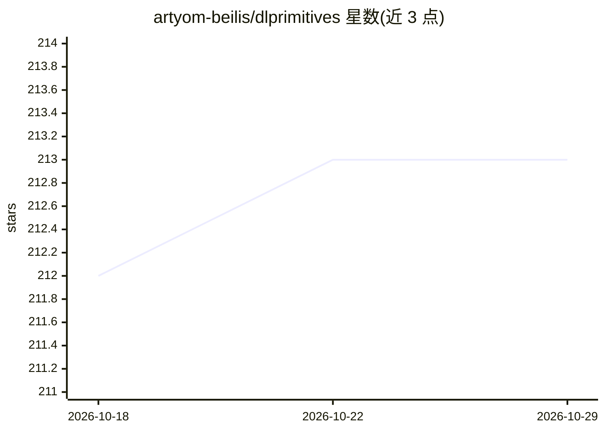

# artyom-beilis/dlprimitives

⭐ 213 · C++ · MIT · 推送 2026-10-23 · [GitHub](https://github.com/artyom-beilis/dlprimitives) · [官网](http://blog.dlprimitives.org/) · 个人维护

**面向 OpenCL 的跨平台深度学习算子库与迷你框架**

为深度学习训练与推理提供基于 OpenCL 的跨平台算子库：包含类似 cuDNN/MIOpen 的原语库、低依赖推理库（支持 ONNX 模型加载，在 ImageNet 网络上测试）以及作为能力验证的极简深度学习框架。算子覆盖卷积（GEMM/Winograd/深度可分离）、池化、归一化、激活等，含 SGD/Adam 优化器。已与 PyTorch（out-of-tree 后端）和 Caffe-OpenCL 集成，测试 GPU 覆盖 AMD/Intel/NVIDIA/ARM/Apple。README 声明项目处于早期进行中阶段。

## 筛选速览

| 维度 | 判定 | 备注 |
|---|---|---|
| AI 角色 | `ai-ecosystem` | LLM/agent 周边工具 |
| 许可风险 | `permissive` | MIT |
| 部署形态 | `None` |  |
| 模型依赖 | — | README 未给出锁定关系 |
| 硬件要求 | — | 无带数字的原话,不猜 |
| 安装摩擦 | `medium` | 含编译或系统依赖之一 |
| 成熟度 | `idea` | |

## 能力要点

- 跨平台 OpenCL 深度学习算子库，支持多种 GPU 架构
- ONNX 模型加载与推理，在多组 ImageNet 网络上测试
- 算子含卷积（GEMM/Winograd/深度可分离）、池化、BatchNorm 等，含 SGD/Adam
- 与 PyTorch、Caffe-OpenCL 的集成项目

## 适用场景

- 在非 CUDA GPU（AMD/Intel/ARM/Apple）上运行深度学习训练与推理
- 加载 ONNX 模型做跨平台 GPU 推理
- 为现有框架接入厂商无关的 OpenCL 后端

## 场景标签

`推理引擎` `模型训练` · 领域:训练与推理

## 证据(README 行号)

> L3: This project aims to provide cross platform OpenCL tools for deep learning and inference.
> L13: - Create an open source, cross platform deep learning primitives library similar to cuDNN or MIOpen that supports
> L15: - Create an inference library with minimal dependencies for efficient inference on any modern GPU, similar to Tenso

## 星数曲线

2026-10-18 212 → 2026-10-29 213（+1）

---
*卡片 v1 · prompt 1.4 · 生成 2026-10-22 · 置信度 high · 依据 README sha `5a23440b0e23` · [字段定义](../../DATASET.md)*
