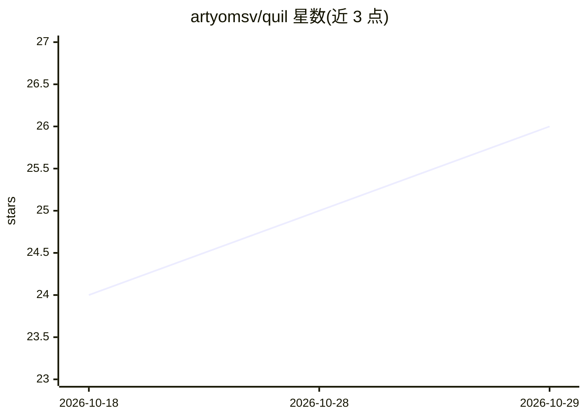

# artyomsv/quil

⭐ 26 · Go · Apache-2.0 · 推送 2026-10-28 · [GitHub](https://github.com/artyomsv/quil) · [官网](https://quil.cc/) · 个人维护

**面向 AI 开发的持久化终端复用器：重启后恢复工作区与 AI 会话**

用 Go 编写的终端复用器，定位为 tmux 的替代品，面向同时编排多个 AI 助手、构建监视器与 SSH 连接的开发者。核心机制：以项目为单位组织标签页与类型化窗格，整个工作区跨重启持久化并按 session id 自动恢复 Claude Code/OpenCode/Codex 会话；内置 MCP 服务器供 AI agent 列出窗格、读取输出、发送按键；支持通过单一 SSH 通道在远程机器运行工作负载（远程仅限 Linux/macOS），可为 Claude Code/Codex/OpenCode 提供 Docker 容器或 microVM 沙箱窗格。跨平台，Apache-2.0。

## 筛选速览

| 维度 | 判定 | 备注 |
|---|---|---|
| AI 角色 | `ai-enhanced` | 去掉 AI 部分产品仍成立 |
| 许可风险 | `permissive` | Apache-2.0 |
| 部署形态 | `desktop` | 安装包/桌面程序 |
| 模型依赖 | — | README 未给出锁定关系 |
| 硬件要求 | — | 无带数字的原话,不猜 |
| 安装摩擦 | `low` | 无编译、无系统依赖或容器化 |
| 成熟度 | — | 结构信号不足 |

## 能力要点

- 工作区跨重启持久化，约 30 秒恢复窗格、目录与 AI 会话
- 内置 MCP 服务器：agent 可列出窗格、读取输出、发送按键
- SSH 单通道远程模式，远程裸机可被推送安装，无需开放端口
- 可选 Docker/microVM 沙箱窗格，checkout 以 bind-mount 为边界运行 agent

## 适用场景

- 在多个项目中并行管理 5-10 个 AI 助手与终端会话，重启后原地恢复
- 让 AI agent 通过 MCP 直接驱动终端窗格执行操作
- 笔记本合盖时让远程 GPU 主机上的 agent 会话继续运行

## 场景标签

 · 领域:开发工具/终端

## 证据(README 行号)

> L11: A terminal multiplexer built for developers who orchestrate 5–10 sessions per project across AI assistants, build w
> L13: Type `quil` after a reboot — every tab, pane, working directory, layout split, and AI conversation is right where y
> L28: |Panes, working dirs, and AI sessions snap back in ~30s.|Expose Quil over MCP — agents list panes, read output, sen

## 星数曲线

2026-10-18 24 → 2026-10-29 26（+2）

---
*卡片 v1 · prompt 1.4 · 生成 2026-10-27 · 置信度 high · 依据 README sha `fac61d2d3964` · [字段定义](../../DATASET.md)*
