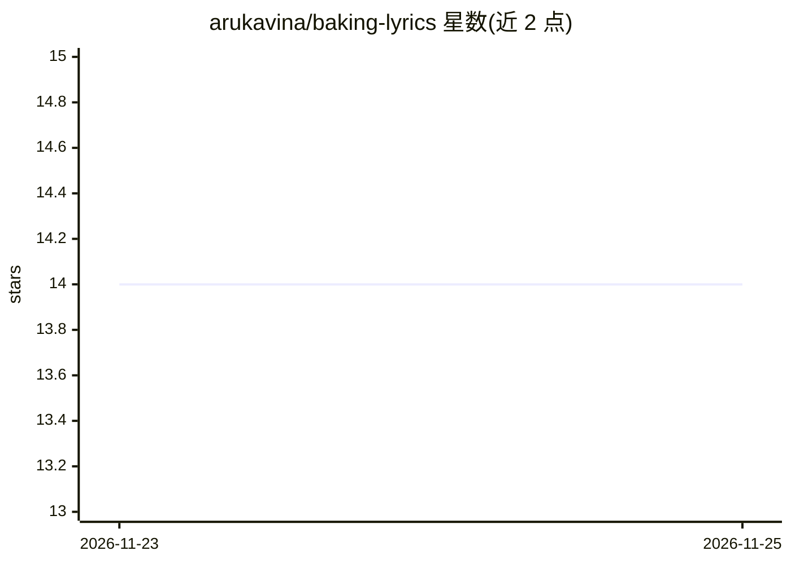

# arukavina/baking-lyrics

⭐ 14 · Python · GPL-3.0 · 推送 2026-11-22 · [GitHub](https://github.com/arukavina/baking-lyrics) · 组织维护

**面向创作者的机器学习歌词与歌名自动生成服务**

基于机器学习与深度学习模型的歌词生成项目，可按乐队/歌手风格生成歌词与标题，当前仅支持英语（计划支持西语）。技术栈为 Python/Flask，模型采用 Skip-Thought Vectors、Encoder-Decoder（含注意力）与 trigram 语言模型，训练语料来自在线歌词数据库。以 API 形式运行，提供 Swagger UI；模型文件与歌词数据集需向作者索取，未附带可下载资源。

## 筛选速览

| 维度 | 判定 | 备注 |
|---|---|---|
| AI 角色 | `ai-native` | 本体是模型或模型工具 |
| 许可风险 | `viral` | GPL-3.0 |
| 部署形态 | `None` |  |
| 模型依赖 | — | README 未给出锁定关系 |
| 硬件要求 | — | 无带数字的原话,不猜 |
| 安装摩擦 | `low` | 无编译、无系统依赖或容器化 |
| 成熟度 | — | 结构信号不足 |

## 能力要点

- 基于 Skip-Thought Vectors（arXiv:1506.06726）的当前模型
- Encoder-Decoder（含注意力）与 trigram 两种建模路径
- Flask API + Swagger UI（http://localhost:9090/api/v1/）
- 支持 SQLite 默认库与 postgres:// 连接串、Redis 限流存储

## 适用场景

- 按喜爱乐队或歌手的风格生成歌词素材
- 自托管歌词生成 API 服务
- 学习 Encoder-Decoder/N-gram 文本生成的实现示例

## 场景标签

`AI 写作` · 领域:内容生成

## 证据(README 行号)

> L18: Baking-Lyrics works based on a group of Machine and Deep learning models that generates music lyrics and titles aut
> L26: Baking lyrics is an automatic generator of lyrics based on a natural language model that is trained using the large
> L104: _This is Baking-Lyrics current model_

## 星数曲线

2026-11-23 14 → 2026-11-25 14（+0）

---
*卡片 v1 · prompt 1.4 · 生成 2026-11-23 · 置信度 mid · 依据 README sha `ebffad792198` · [字段定义](../../DATASET.md)*
