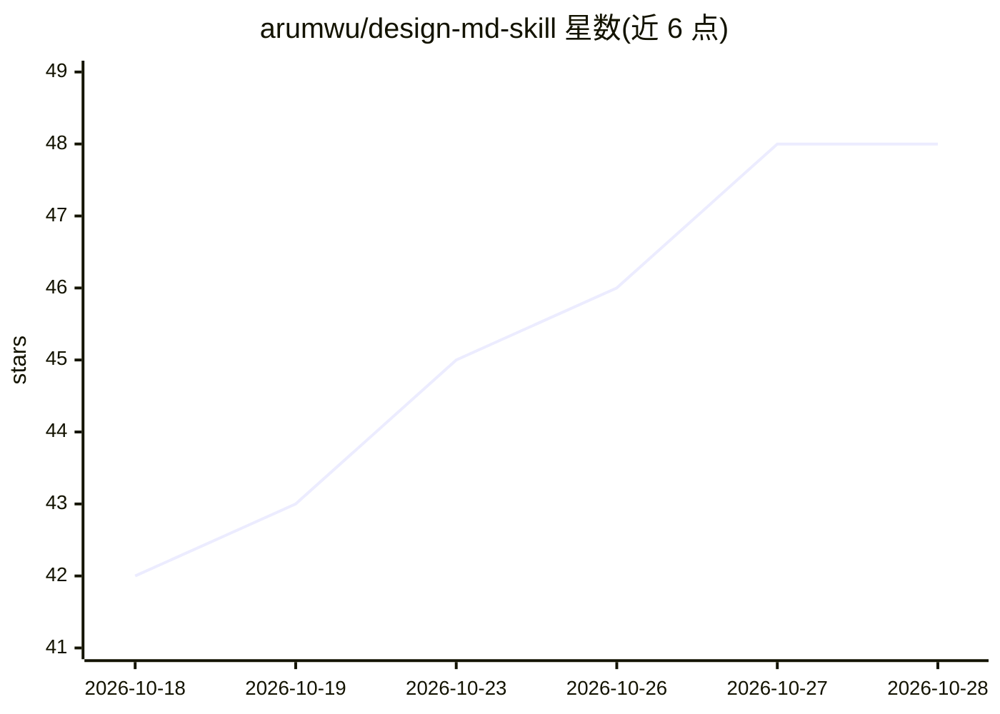

# arumwu/design-md-skill

⭐ 48 · MIT · 推送 2026-07-12 · [GitHub](https://github.com/arumwu/design-md-skill) · 个人维护 · 中文 README

**Claude/agent 技能：把 74 个品牌设计系统变成可挑选的参考索引**

面向编码 agent 的 SKILL.md 技能：提供 74 个真实品牌设计系统（Claude、Linear、Stripe、Apple 等，按 9 类分组）的紧凑索引，每条含主色与一句话风格描述。用户以品牌语言描述 UI 需求后，agent 按情绪与主色挑选品牌，加载对应 DESIGN.md 并以其色彩角色、字阶、组件与阴影规范作为硬规格生成界面。设计内容来自 voltagent/awesome-design-md（MIT），本仓库仅是索引与工作流层，需单独 clone 上游设计库，运行时按 DESIGN_MD_DIR 或常见路径定位，缺失时可提示 clone。支持 Claude Code、Claude Agent SDK、OpenClaw 等加载 SKILL.md 式技能的运行时。

## 筛选速览

| 维度 | 判定 | 备注 |
|---|---|---|
| AI 角色 | `ai-knowledge` | 知识聚合/清单类 |
| 许可风险 | `permissive` | MIT |
| 部署形态 | `None` |  |
| 模型依赖 | locked-api |  |
| 硬件要求 | — | 无带数字的原话,不猜 |
| 安装摩擦 | `low` | 无编译、无系统依赖或容器化 |
| 成熟度 | — | 结构信号不足 |

## 能力要点

- 74 个品牌设计系统的分类索引，每条含主色与一句话风格
- agent 按情绪+主色挑选品牌并加载完整 DESIGN.md 作为硬规格
- 单文件 SKILL.md 即可安装，设计库按需定位或 clone
- 可衔接 frontend-design → tailwind-design-system → shadcn → design-review 技能链

## 适用场景

- 让编码 agent 按 Linear/Stripe/Apple 等品牌风格生成 UI
- 避免 agent 自行拼凑配色与排版规范
- 按类别和主色快速查找可复用的设计系统参考

## 场景标签

`精选清单` `提示工程` · 领域:Agent 开发

## 证据(README 行号)

> L3: **A Claude / agent skill that turns 74 real-world brand design systems into a pick-and-build reference library.**
> L19: - **`SKILL.md`** — the skill itself: trigger description, workflow, and the full **74-brand index** (each with its 
> L20: - The actual design systems (`DESIGN.md` + `preview.html` + `preview-dark.html` per brand) live in voltagent/awesom

## 星数曲线

2026-10-18 42 → 2026-10-28 48（+6）

---
*卡片 v1 · prompt 1.4 · 生成 2026-10-25 · 置信度 high · 依据 README sha `4d2286516547` · [字段定义](../../DATASET.md)*
