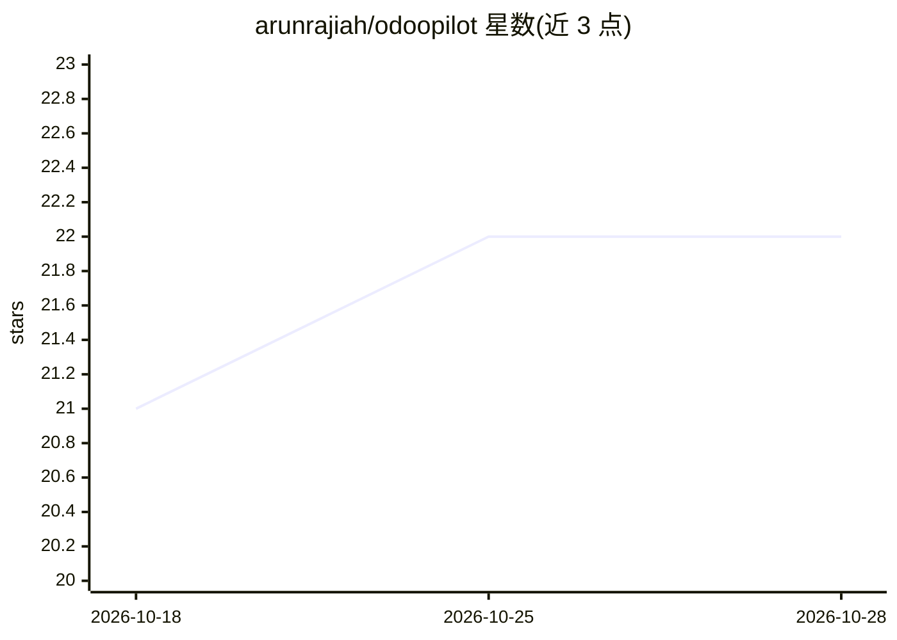

# arunrajiah/odoopilot

⭐ 22 · Python · NOASSERTION · 推送 2026-10-09 · [GitHub](https://github.com/arunrajiah/odoopilot) · [官网](https://apps.odoo.com/apps/modules/18.0/odoopilot) · 个人维护

**Odoo 内部团队 AI 助手：Telegram/WhatsApp 聊天操作 ERP**

以纯 Odoo 插件形式自托管的员工 AI 助手：员工通过 Telegram、WhatsApp 或 Odoo 内网页聊天组件，以自然语言查询任务、CRM、发票、库存、HR 等数据并执行写操作（写前需 Yes/No 确认按钮）。每个聊天用户绑定 Odoo 账户，权限与审计轨迹与 Odoo 一致。LLM 后端可选 Anthropic、OpenAI、Groq 或本地 Ollama；支持 15 种界面语言与 Whisper 语音转写。安装方式为复制插件目录到 addons 路径并更新模块，或从 Odoo App Store 安装。

## 筛选速览

| 维度 | 判定 | 备注 |
|---|---|---|
| AI 角色 | `ai-native` | 本体是模型或模型工具 |
| 许可风险 | `none` | NOASSERTION |
| 部署形态 | `None` |  |
| 模型依赖 | local-ok | 支持本地模型 |
| 硬件要求 | — | 无带数字的原话,不猜 |
| 安装摩擦 | `medium` | 含编译或系统依赖之一 |
| 成熟度 | — | 结构信号不足 |

## 能力要点

- 19 个 ORM 工具覆盖 8 个 Odoo 应用（项目/CRM/销售/发票/库存/HR/采购）
- 写操作前强制 Yes/No 确认门，所有 AI 操作写入不可变审计日志
- 四选一 LLM 后端：Claude、GPT-4o、Groq、Ollama（可 100% 本地）
- Whisper 语音消息转写走同一 agent 循环（Groq 免费档可用）

## 适用场景

- 外勤销售、仓库员工不登录 Odoo 直接聊天请假、审批、查库存
- 管理层通过聊天确认销售订单、更新 CRM 阶段
- 团队用本地 Ollama 部署，数据不出服务器

## 场景标签

`AI 助手` `聊天机器人` · 领域:对话与助手

## 证据(README 行号)

> L18: OdooPilot gives every employee an AI assistant on Telegram or WhatsApp that connects to the
> L21: with a bot in their own language. No Odoo login, no app to install, no training.

## 星数曲线

2026-10-18 21 → 2026-10-28 22（+1）

---
*卡片 v1 · prompt 1.4 · 生成 2026-10-27 · 置信度 high · 依据 README sha `e0f15ecb745a` · [字段定义](../../DATASET.md)*
