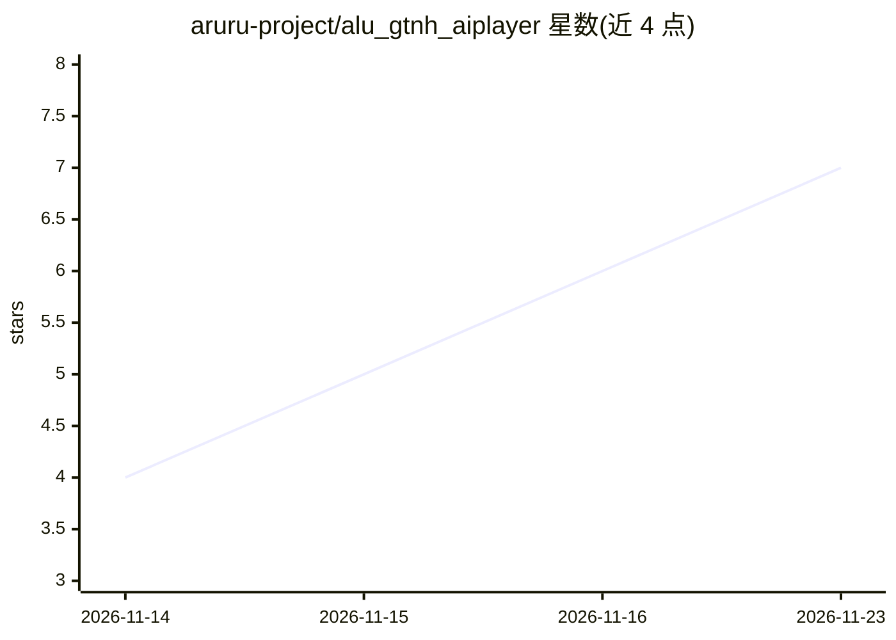

# aruru-project/alu_gtnh_aiplayer

⭐ 7 · TypeScript · MIT · 推送 2026-11-19 · [GitHub](https://github.com/aruru-project/alu_gtnh_aiplayer) · 个人维护 · 中文 README

**GTNH 服务器里的 AI 玩家：LLM 驱动的 Forge mod + Node 大脑**

面向 Minecraft 1.7.10 GTNH 服务器的一个服务端 Forge mod（身体）加独立 Node 服务（大脑）组成的 AI 玩家实体：按生存规则行走、挖掘、建造、使用箱子与 GregTech 机器，由大模型决策。大脑分对话线与干活线，各用独立模型与上下文；带网页面板配置 API key 并查看行为。需要自备大模型接口（OpenAI 或 Anthropic 兼容）、GTNH 2.9.0 服务器与客户端整合包导出的资料，README 自述为实验性质，未经正式服长期运行验证。

## 筛选速览

| 维度 | 判定 | 备注 |
|---|---|---|
| AI 角色 | `ai-native` | 本体是模型或模型工具 |
| 许可风险 | `permissive` | MIT |
| 部署形态 | `None` |  |
| 模型依赖 | — | README 未给出锁定关系 |
| 硬件要求 | — | 无带数字的原话,不猜 |
| 安装摩擦 | `low` | 无编译、无系统依赖或容器化 |
| 成熟度 | `idea` | |

## 能力要点

- 服务端 Forge mod 无需客户端安装，动作任务队列存世界存档、重启后继续
- 对话与干活双线分离，干活期间仍可应答与叫停
- 支持按 Schematica 图纸建造与模型生成图纸草稿的三维预览
- 产线规划复用 GTNH Factory Flow / GTNH Planner 与 HiGHS WASM 本地求解

## 适用场景

- 在 GTNH 服务器上养一个代挂的 AI 玩家，不在线也能继续干活
- 用自然语言让 AI 玩家整地、照图纸盖建筑、操作 GT 机器加工
- 让它帮忙查配方、任务书和物品存在位置

## 场景标签

`AI 助手` `聊天机器人` · 领域:对话与助手

## 证据(README 行号)

> L3: GTNH（GT New Horizons，Minecraft 1.7.10）服务器里的 AI 玩家：一个真的玩家实体，按生存规则走路、挖、放、开箱子、用机器，由大模型决定做什么。主人在不在线它都能接着干。
> L8: - **大脑** `brain/`：独立的后台服务。听游戏里的聊天，调大模型，指挥身体；带网页面板，用来配置模型服务和 API key、看它在想什么和做什么。大脑里是“一个玩家，两条线”：**对话线**跟人说话和查资料，**干活线*
> L21: - 一个大模型的接口：OpenAI 兼容（Chat Completions）或 Anthropic 兼容（Messages）都行，在面板里填。要能调工具；上下文越大越好（它每一步都带着几万到二十多万 token 的上下文）。

## 星数曲线

2026-11-14 4 → 2026-11-23 7（+3）

---
*卡片 v1 · prompt 1.4 · 生成 2026-11-20 · 置信度 high · 依据 README sha `cac10e400e1d` · [字段定义](../../DATASET.md)*
