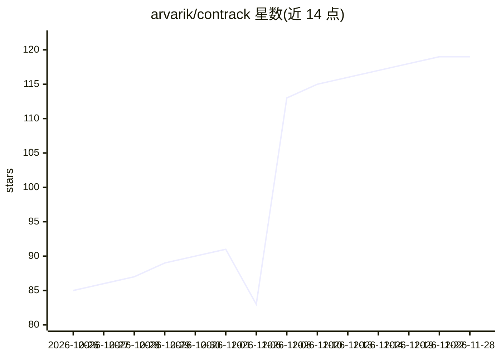

# arvarik/contrack

⭐ 119 · TypeScript · AGPL-3.0 · 推送 2026-11-23 · [GitHub](https://github.com/arvarik/contrack) · [官网](https://arvarik.com/contrack) · 个人维护

**自托管的个人联系人管理与追踪应用，支持 AI 富化**

自托管的联系人管理应用，按导入→去重→富化→追踪四步流程工作：从 Apple、Google、LinkedIn、Facebook 导入联系人，合并重复档案，通过笔记或网页研究补全资料并给出引用来源，按设定频率提醒跟进。AI 为可选用途：自然语言提问 Ask Contrack 在本机私有搜索，MCP 接入 Claude、ChatGPT、Cursor 等客户端读取上下文并记录笔记，可不使用任何模型。数据存储于本地 Docker 卷，AGPL v3 许可，提供 Docker 镜像、源码构建与在线演示。

## 筛选速览

| 维度 | 判定 | 备注 |
|---|---|---|
| AI 角色 | `ai-enhanced` | 去掉 AI 部分产品仍成立 |
| 许可风险 | `viral` | AGPL-3.0 |
| 部署形态 | `self-host` | docker 或自建部署 |
| 模型依赖 | — | README 未给出锁定关系 |
| 硬件要求 | — | 无带数字的原话,不猜 |
| 安装摩擦 | `low` | 无编译、无系统依赖或容器化 |
| 成熟度 | — | 结构信号不足 |

## 能力要点

- 导入→去重→富化→追踪四步联系人管理流程，合并操作支持 90 天撤销
- MCP 服务器一键接入 Claude、ChatGPT、Cursor 等客户端，支持只读权限
- Ask Contrack 自然语言搜索联系人，搜索在本机完成
- 一键完整性校验备份与定时自动备份，多档案隔离地址簿

## 适用场景

- 把分散在多个通讯录的联系人合并到自托管的一份档案
- 用日常笔记和自然语言维护人脉并收到跟进提醒
- 与家人或团队共用一台家庭服务器且彼此档案隔离
- 让 Claude/Cursor 等 AI 助手查询联系人上下文并代记笔记

## 场景标签

`语义搜索` · 领域:知识与检索

## 证据(README 行号)

> L18: Contrack solves all of these by being an all-in-one, self-hosted contact management app that a follows a simple 4 s
> L48: Ask in plain words, like "Who do I know in Lisbon?" or "Who loves natural wine?" Answers come straight from your ow
> L80: Share one home server with your family or team while keeping everyone's address book completely private to them. An

## 星数曲线

2026-10-26 85 → 2026-11-28 119（+34）

---
*卡片 v1 · prompt 1.4 · 生成 2026-11-28 · 置信度 high · 依据 README sha `7afe03ea8b96` · [字段定义](../../DATASET.md)*
