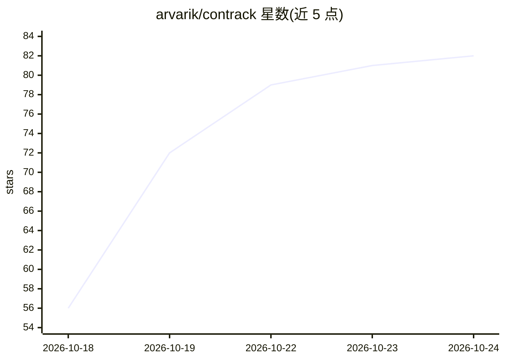

# arvarik/contrack

⭐ 83 · TypeScript · AGPL-3.0 · 推送 2026-10-20 · [GitHub](https://github.com/arvarik/contrack) · [官网](https://arvarik.com/contrack) · 个人维护

**自托管的个人/团队联系人管理与追踪应用，含可选 AI 增强**

本地优先、隐私导向的自托管联系人管理应用，遵循 Import→Dedupe→Enrich→Track 流程：从 Apple/Google/LinkedIn/Facebook 导入联系人并自动去重（90 天可撤销合并），将自然语言笔记转化为含日期、标签与提醒的完整档案，并可经网络调研补全人物信息与来源引用。提供每日简报 Pulse、基于自有数据的自然语言问答 Ask Contrack、地图视图、多账户隔离地址簿与校验备份。AI 功能可选接入（含 MCP/API 对接 Claude、Cursor 等客户端），也可完全不用 AI 运行；通过 Docker 或源码（Node.js 26.10+）部署。

## 筛选速览

| 维度 | 判定 | 备注 |
|---|---|---|
| AI 角色 | `ai-enhanced` | 去掉 AI 部分产品仍成立 |
| 许可风险 | `viral` | AGPL-3.0 |
| 部署形态 | `self-host` | docker 或自建部署 |
| 模型依赖 | — | README 未给出锁定关系 |
| 硬件要求 | — | 无带数字的原话,不猜 |
| 安装摩擦 | `low` | 无编译、无系统依赖或容器化 |
| 成熟度 | — | 结构信号不足 |

## 能力要点

- 多来源联系人导入与自动去重合并（90 天撤销）
- 自然语言笔记转结构化档案（日期/标签/提醒）与带来源引用的联系人网络调研
- Ask Contrack 基于本地联系人数据问答，搜索在本机执行
- MCP/API 一键对接 Claude、ChatGPT、Cursor 等客户端，支持只读模式

## 适用场景

- 把散落在各应用的联系人合并成一份可自持的网络
- 维护家人或团队的联系人并保持跟进提醒
- 让 AI 助手查联系人背景并记录笔记

## 场景标签

`语义搜索` · 领域:知识与检索

## 证据(README 行号)

> L18: Contrack solves all of these by being an all-in-one, self-hosted contact management app that a follows a simple 4 s
> L78: **Privacy isn't a setting. It's the foundation.** Contrack lives on your own computer or home server. Your relation
> L101: Then open http://localhost:3210. There is no cloud account to sign up for and no API key required. Everything stay

## 星数曲线

2026-10-18 56 → 2026-10-24 82（+26）

---
*卡片 v1 · prompt 1.4 · 生成 2026-10-24 · 置信度 mid · 依据 README sha `3b06a937a462` · [字段定义](../../DATASET.md)*
