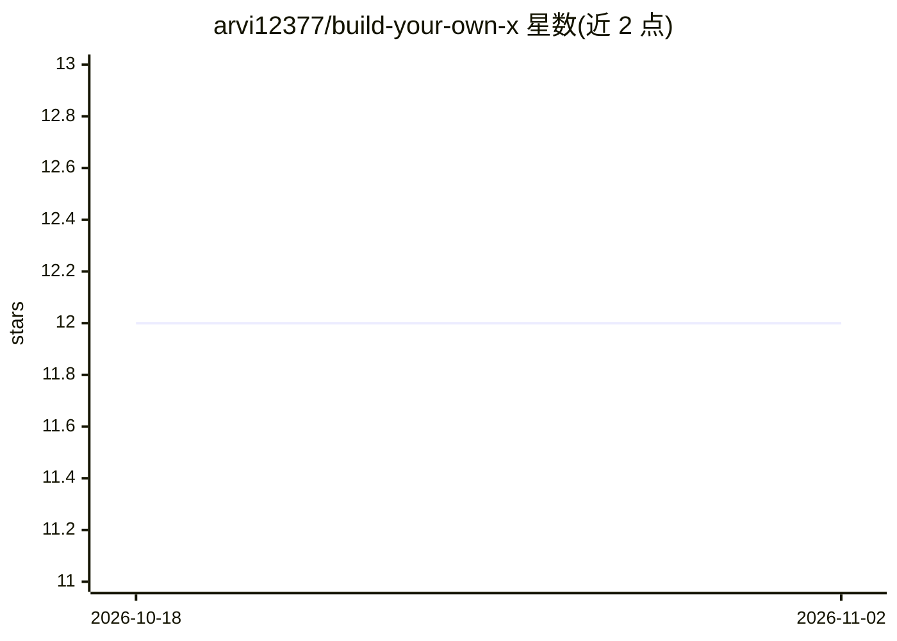

# arvi12377/build-your-own-x

⭐ 12 · Markdown · 推送 2026-10-12 · [GitHub](https://github.com/arvi12377/build-your-own-x) · 个人维护

**通过从零重建流行技术来学习编程的教程资源库**

以“边造边学”为目标的教程与代码示例集合，主题覆盖 Web 开发、机器学习（神经网络与模型基础）、移动应用等，提供分步教程、完整源码示例与交互式编程练习。README 以可下载应用的形式组织：从 Releases 页面下载压缩包，解压后按 Windows/macOS/Linux 各自方式运行。社区部分列出讨论论坛、反馈渠道与学习活动。注意其安装说明指向仓库内 raw 路径的 zip 文件。

## 筛选速览

| 维度 | 判定 | 备注 |
|---|---|---|
| AI 角色 | `ai-knowledge` | 知识聚合/清单类 |
| 许可风险 | `none` | — |
| 部署形态 | `desktop` | 安装包/桌面程序 |
| 模型依赖 | — | README 未给出锁定关系 |
| 硬件要求 | — | 无带数字的原话,不猜 |
| 安装摩擦 | `low` | 无编译、无系统依赖或容器化 |
| 成熟度 | — | 结构信号不足 |

## 能力要点

- 分步教程：从零重建流行技术
- 提供完整源码示例与交互式编程练习
- 主题覆盖 Web 开发、机器学习、移动应用

## 适用场景

- 通过从零重建 Web/移动应用来练手
- 学习神经网络与模型的基础实现
- 在教程代码基础上做修改实验

## 场景标签

`教程课程` · 领域:学习与行业

## 证据(README 行号)

> L7: Welcome to **build-your-own-x**! This project aims to help you master programming by recreating your favorite techno
> L44: - **Step-by-Step Tutorials:** Walkthroughs for recreating popular technologies.
> L52: - **Machine Learning:** Understand the basics of neural networks and models.

## 星数曲线

2026-10-18 12 → 2026-11-02 12（+0）

---
*卡片 v1 · prompt 1.4 · 生成 2026-11-01 · 置信度 mid · 依据 README sha `81e746ddcb42` · [字段定义](../../DATASET.md)*
