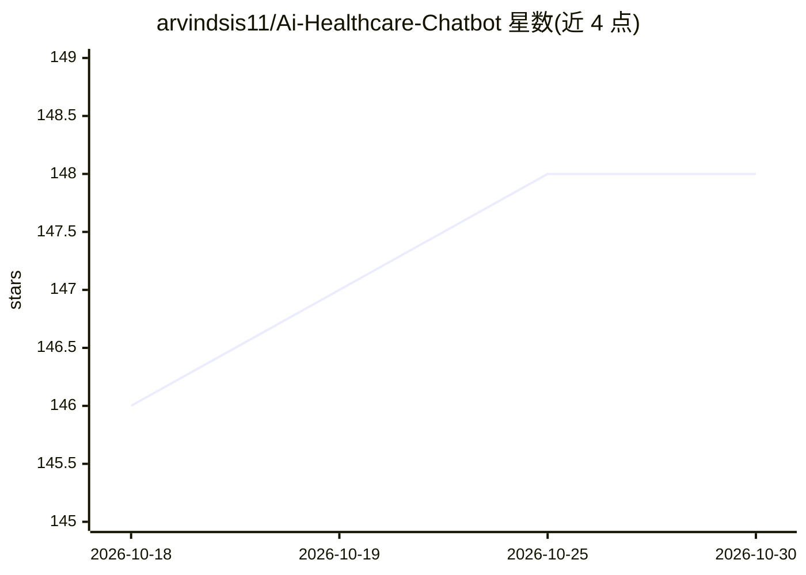

# arvindsis11/Ai-Healthcare-Chatbot

⭐ 148 · Python · 推送 2026-06-12 · [GitHub](https://github.com/arvindsis11/Ai-Healthcare-Chatbot) · [官网](https://ai-healthcare-frontend.onrender.com/) · 个人维护

**面向患者与医疗场景的 RAG 医疗健康问答聊天机器人平台**

FastAPI 后端 + Next.js 前端的全栈医疗健康对话应用：通过 RAG 流水线（语义检索 + 词法重排）生成带临床来源引用的回答，支持症状抽取、低/中/高三级风险分诊、专科医生推荐与多语言检测。安全层包含提示注入防护、速率限制、Pydantic 输入校验与自动医疗免责声明。以 Docker Compose 一键部署或源码安装，声明仅供教育用途、不替代专业医疗建议。路线图列出后续 API 平台、远程医疗与临床决策支持阶段。

## 筛选速览

| 维度 | 判定 | 备注 |
|---|---|---|
| AI 角色 | `ai-native` | 本体是模型或模型工具 |
| 许可风险 | `none` | — |
| 部署形态 | `self-host` | docker 或自建部署 |
| 模型依赖 | — | README 未给出锁定关系 |
| 硬件要求 | — | 无带数字的原话,不猜 |
| 安装摩擦 | `low` | 无编译、无系统依赖或容器化 |
| 成熟度 | — | 结构信号不足 |

## 能力要点

- RAG 流水线：语义检索 + 词法重排 + 分块临床引用
- 症状抽取与低/中/高三级风险分诊、专科推荐
- 提示注入防护、速率限制、输入校验等安全层
- Docker Compose 一键全栈部署

## 适用场景

- 通过对话获取带临床来源引用的健康教育信息
- 输入症状获得风险分级与就诊科室建议
- 作为毕业设计或医疗 AI 应用原型部署学习

## 场景标签

`聊天机器人` `RAG` · 领域:对话与助手

## 证据(README 行号)

> L20: - 🤖 **Intelligent RAG** – Retrieval-Augmented Generation with semantic search, hybrid reranking, and clinical citat
> L56: - **Source Citations** – Every response includes clinical sources and evidence excerpts

## 星数曲线

2026-10-18 146 → 2026-10-30 148（+2）

---
*卡片 v1 · prompt 1.4 · 生成 2026-10-22 · 置信度 high · 依据 README sha `9b9b137a7bfc` · [字段定义](../../DATASET.md)*
