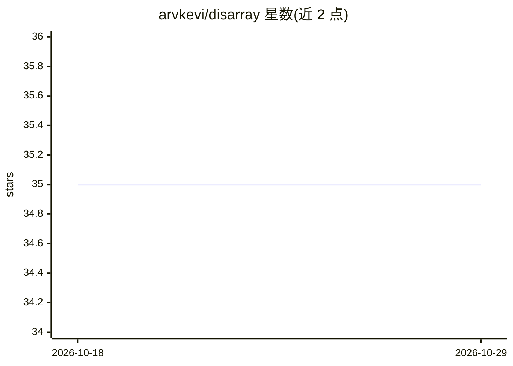

# arvkevi/disarray

⭐ 35 · Python · MIT · 推送 2026-07-06 · [GitHub](https://github.com/arvkevi/disarray) · 个人维护

**从 pandas DataFrame 直接计算混淆矩阵指标的扩展库**

注册为 pandas 扩展访问器（df.da.）的 Python 库：从由方形非负整数数组实例化的 DataFrame 中计算混淆矩阵派生指标。支持二分类与多分类场景，存储每类 TP/FP/FN/TN 计数，提供 accuracy、precision、recall、f1、sensitivity 等指标及各自的 micro-average，可通过 export_metrics() 导出选定指标为新 DataFrame。要求输入为方形正整数数组（Windows 用户需指定 dtype=int）。

## 筛选速览

| 维度 | 判定 | 备注 |
|---|---|---|
| AI 角色 | `ai-ecosystem` | LLM/agent 周边工具 |
| 许可风险 | `permissive` | MIT |
| 部署形态 | `library` | 以包/库形式分发 |
| 模型依赖 | — | README 未给出锁定关系 |
| 硬件要求 | — | 无带数字的原话,不猜 |
| 安装摩擦 | `low` | 无编译、无系统依赖或容器化 |
| 成熟度 | — | 结构信号不足 |

## 能力要点

- 以 pandas 扩展访问器 df.da. 形式注册，使用方式类似 pandas 属性
- 支持二分类与多分类混淆矩阵
- 提供每类 TP/FP/FN/TN 计数与多项指标及 micro-average
- export_metrics() 按选定指标列表导出 DataFrame

## 适用场景

- 数据科学项目中直接在 pandas 内查看分类模型性能指标
- 比较多类别分类任务中各类别的指标表现
- 将常用混淆矩阵指标批量导出用于存储或可视化

## 场景标签

 · 领域:数据科学/机器学习评测

## 证据(README 行号)

> L7: `disarray` calculates metrics derived from a confusion matrix and makes them directly accessible from a pandas DataF
> L34: The `disarray` package is intended to be used similar to a `pandas` attribute or method. `disarray` is registered a
> L71: Use `df.da.export_metrics()` to store and/or visualize many common performance metrics in a new `pandas` DataFrame

## 星数曲线

2026-10-18 35 → 2026-10-29 35（+0）

---
*卡片 v1 · prompt 1.4 · 生成 2026-10-25 · 置信度 high · 依据 README sha `d6f3542e1f04` · [字段定义](../../DATASET.md)*
