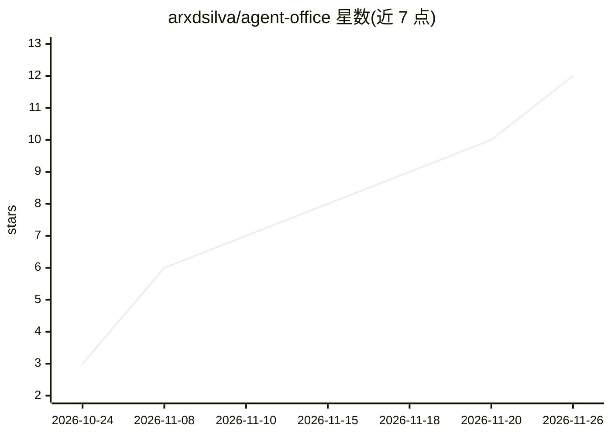

# arxdsilva/agent-office

⭐ 12 · TypeScript · MIT · 推送 2026-11-16 · [GitHub](https://github.com/arxdsilva/agent-office) · 个人维护

**为 AI 编码 agent 提供共享项目记忆与交接的桌面工作台**

面向 macOS/Windows/Linux 的桌面应用：把项目的会话、记忆、决策、任务与交接保存在本地加密库中，并以 3D/2D 办公室视图展示各 agent 的状态。核心机制包括带审核与来源追溯的共享记忆、按规模预算排序上下文的 Context Engine、本地 MCP 服务器（search_memory 等工具、会话级令牌）、可版本化的 Harness 规则与校验门、跨 provider 的上下文 bundle 交接。局限：交接需要目标 provider 有受管运行时，shell 命令规则无 OS 沙箱时最多部分强制。

## 筛选速览

| 维度 | 判定 | 备注 |
|---|---|---|
| AI 角色 | `ai-ecosystem` | LLM/agent 周边工具 |
| 许可风险 | `permissive` | MIT |
| 部署形态 | `desktop` | 安装包/桌面程序 |
| 模型依赖 | locked-api |  |
| 硬件要求 | — | 无带数字的原话,不猜 |
| 安装摩擦 | `medium` | 含编译或系统依赖之一 |
| 成熟度 | — | 结构信号不足 |

## 能力要点

- 共享记忆需人工审核批准，条目带来源追溯与版本
- Context Engine 按相关性、时效与预算生成可解释的上下文 bundle
- 本地 MCP 服务器提供 search_memory 等工具，会话级作用域令牌
- Harness 支持多 provider 共用规则、校验门与合规检查器

## 适用场景

- 多个 AI 编码工具共用同一项目的记忆与标准
- 把一个 provider 的会话任务交接给另一个
- 审计 agent 实际收到的上下文与规则执行情况
- 将已有 AGENTS.md/CLAUDE.md/Cursor 规则导入为版本化标准

## 场景标签

`Agent 记忆` `编码 Agent` · 领域:Agent 开发

## 证据(README 行号)

> L5: An agent is temporary. A project is persistent. agent-office is a desktop app (macOS, Windows, Linux) that keeps you
> L21: - **Any provider, one place.** Claude Code, Codex, Cursor, Gemini, Copilot and any HTTP agent share the same projec
> L49: - **Project MCP server.** Managed sessions can retrieve approved memory through a local MCP server with the tools `

## 星数曲线

2026-10-24 3 → 2026-11-26 12（+9）

---
*卡片 v1 · prompt 1.4 · 生成 2026-11-20 · 置信度 high · 依据 README sha `0c095b7f78eb` · [字段定义](../../DATASET.md)*
