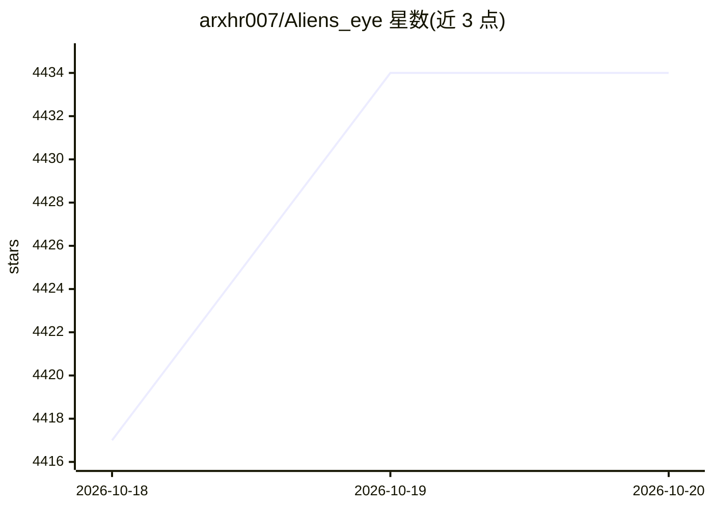

# arxhr007/Aliens_eye

⭐ 4,434 · Python · MIT · 推送 2026-10-19 · [GitHub](https://github.com/arxhr007/Aliens_eye) · 个人维护

**AI 驱动的 OSINT 用户名扫描器：检测 840+ 平台账号**

面向 OSINT 研究者的命令行工具，在 840+ 社交平台异步查找某用户名是否存在账号。检测机制为 30 维特征向量上加权启发式与逻辑回归模型的混合判定，输出 Found/Maybe/Not Found 及置信度，并以不存在的用户名做对照校验。附带画像提取（昵称/简介/头像）、跨站关联聚类、递归扩展、域名检查、定时巡检、可恢复扫描与自检评测（精确率/召回率/F1）。随包模型基于 1,455 样本训练，未见平台上误报率约 1%，支持重训练与主动标注；声明仅供教育与合法 OSINT 用途。可经 pip、Docker 或源码安装。

## 筛选速览

| 维度 | 判定 | 备注 |
|---|---|---|
| AI 角色 | `ai-native` | 本体是模型或模型工具 |
| 许可风险 | `permissive` | MIT |
| 部署形态 | `self-host` | docker 或自建部署 |
| 模型依赖 | — | README 未给出锁定关系 |
| 硬件要求 | — | 无带数字的原话,不猜 |
| 安装摩擦 | `low` | 无编译、无系统依赖或容器化 |
| 成熟度 | — | 结构信号不足 |

## 能力要点

- ML + 30 维结构特征混合判定，输出 Found/Maybe/Not Found 与置信度
- 跨站关联聚类（头像哈希/简介/共享链接）与递归扩展再扫描
- 自检评测与可复现回放：按站点报告 precision/recall/F1/FPR，并与 Sherlock/Maigret/WhatsMyName 规则对比
- 提供 MCP server 将扫描能力暴露给 LLM agent，另有 aliens_eye.api 稳定库接口

## 适用场景

- 调查一个用户名在 840+ 平台的账号分布并导出报告
- 通过头像/简介等信号聚类疑似同一人的多平台账号
- 定时监控目标账号变化并推送 webhook 通知

## 场景标签

`网络安全` · 领域:学习与行业

## 证据(README 行号)

> L9:  Advanced AI-Powered Social Media Username Finder
> L42: - **ML + heuristic detection** — a trained model blended with 30 structural signals (HTTP status, DOM shape, keywor

## 星数曲线

2026-10-18 4,417 → 2026-10-20 4,434（+17）

---
*卡片 v1 · prompt 1.4 · 生成 2026-10-20 · 置信度 high · 依据 README sha `bcf6ffabd7f8` · [字段定义](../../DATASET.md)*
