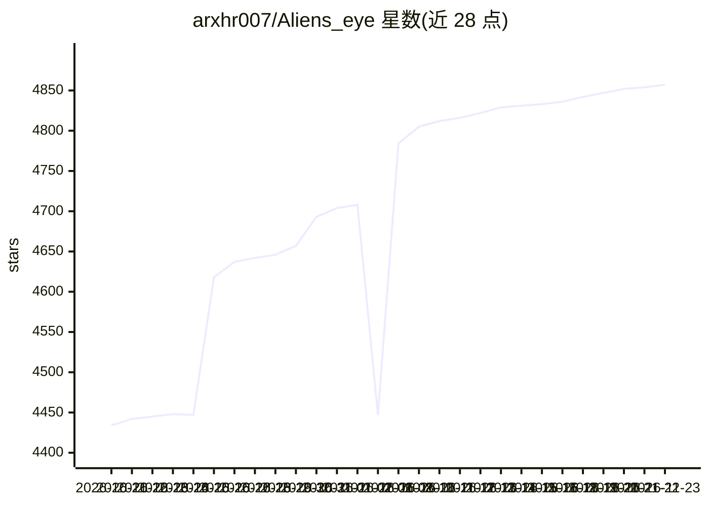

# arxhr007/Aliens_eye

⭐ 4,857 · Python · MIT · 推送 2026-11-22 · [GitHub](https://github.com/arxhr007/Aliens_eye) · [官网](https://arxhr007.github.io/aliens-eye) · 个人维护

**给 OSINT 研究者扫描 7,700+ 平台上的用户名同名账号**

命令行用户名扫描工具：对 7,700+ 平台异步探测用户名，用启发式引擎与随包分发的逻辑回归模型混合打分（0.9*ML+0.1*启发式），输出 Found/Maybe/Not Found 与置信度，并通过 404 判定、机器人页封顶、随机对照用户名三重校验降低误报。支持跨站画像关联、递归用户名扩展、域名注册检查、定时监控、断点续扫，报告输出 JSON/CSV/HTML/MD/PDF/图谱格式，可作 Python 库或 MCP 服务器使用，并提供模型再训练与自检评测命令。

## 筛选速览

| 维度 | 判定 | 备注 |
|---|---|---|
| AI 角色 | `ai-native` | 本体是模型或模型工具 |
| 许可风险 | `permissive` | MIT |
| 部署形态 | `self-host` | docker 或自建部署 |
| 模型依赖 | — | README 未给出锁定关系 |
| 硬件要求 | — | 无带数字的原话,不猜 |
| 安装摩擦 | `low` | 无编译、无系统依赖或容器化 |
| 成熟度 | — | 结构信号不足 |

## 能力要点

- ML+30 维结构特征的混合检测，随包内置模型且纯 Python 运行
- 对照用户名校验与 bot 页降级，将 Found/Maybe 定位为待核实线索
- 跨站关联聚类、递归扩展、watch 模式与断点续扫
- selfcheck 报告 precision/recall/F1/FPR，支持冻结语料复现评测

## 适用场景

- 调查某用户名在全网各平台的注册占用情况
- 聚合同名账号的画像信息并跨站关联
- 定期监控目标用户名的新账号变动并推送 webhook
- 将扫描能力接入 LLM agent（MCP 服务器）或自有工具（Python API）

## 场景标签

`网络安全` · 领域:学习与行业

## 证据(README 行号)

> L42: - **ML + heuristic detection** — a trained model blended with 30 structural signals (HTTP status, DOM shape, keywor
> L113: The blended probability maps to **Found / Maybe / Not Found** with a confidence percentage. The loaded model suppl

## 星数曲线

2026-10-21 4,434 → 2026-11-23 4,857（+423）

---
*卡片 v1 · prompt 1.4 · 生成 2026-11-23 · 置信度 high · 依据 README sha `54f5a5a973fd` · [字段定义](../../DATASET.md)*
