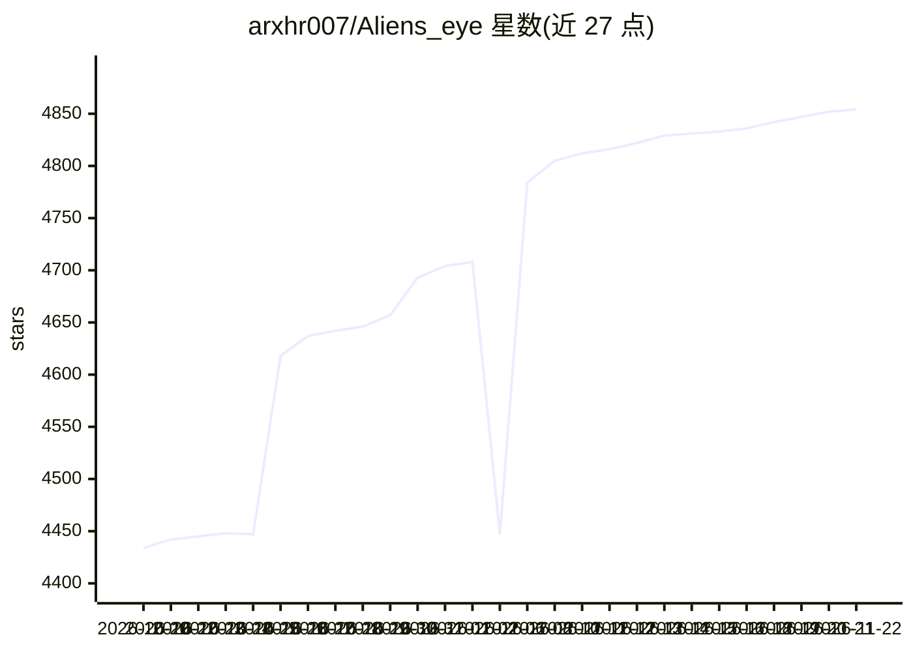

# arxhr007/Aliens_eye

⭐ 4,854 · Python · MIT · 推送 2026-11-19 · [GitHub](https://github.com/arxhr007/Aliens_eye) · [官网](https://arxhr007.github.io/aliens-eye) · 个人维护

**面向 OSINT 调研者的 AI 用户名全网扫描工具，覆盖 7,700+ 平台**

命令行 OSINT 工具，对给定用户名在 7,700+ 平台异步扫描并判定账号是否存在。检测用 30 维 HTML 特征向量加启发式与逻辑回归模型双投票，输出 Found/Maybe/Not Found 与置信度，并经 404、机器人页与随机对照用户名三重复核。提供跨站画像关联、递归用户名扩展、域名注册检查、定时监控、可恢复扫描，报告支持 JSON/CSV/HTML/PDF 等格式。支持自检校准与模型重训练；README 强调结果仅为线索需人工核实。

## 筛选速览

| 维度 | 判定 | 备注 |
|---|---|---|
| AI 角色 | `ai-native` | 本体是模型或模型工具 |
| 许可风险 | `permissive` | MIT |
| 部署形态 | `self-host` | docker 或自建部署 |
| 模型依赖 | — | README 未给出锁定关系 |
| 硬件要求 | — | 无带数字的原话,不猜 |
| 安装摩擦 | `low` | 无编译、无系统依赖或容器化 |
| 成熟度 | — | 结构信号不足 |

## 能力要点

- ML+启发式双引擎判定，输出 Found/Maybe/Not Found 与置信百分比
- 跨站画像关联（头像哈希、bio、共享链接聚类）与递归用户名扩展
- 随机对照用户名与三重复核机制降低误报
- selfcheck/ablation/retrain 支持可复现评估与主动学习标注

## 适用场景

- 调查某个用户名在全网的社交账号分布
- 定时监控目标用户名在各平台的变化并推送 webhook
- 通过 Python API 将扫描能力集成到其他 OSINT 工具

## 场景标签

`网络安全` `网页抓取` · 领域:效率与自动化

## 证据(README 行号)

> L42: - **ML + heuristic detection** — a trained model blended with 30 structural signals (HTTP status, DOM shape, keywor
> L111: 2. **ML model** — logistic regression trained on labeled scans of real (and deliberately fake) accounts, shipped w

## 星数曲线

2026-10-20 4,434 → 2026-11-22 4,854（+420）

---
*卡片 v1 · prompt 1.4 · 生成 2026-11-22 · 置信度 high · 依据 README sha `a3c5adff46ae` · [字段定义](../../DATASET.md)*
