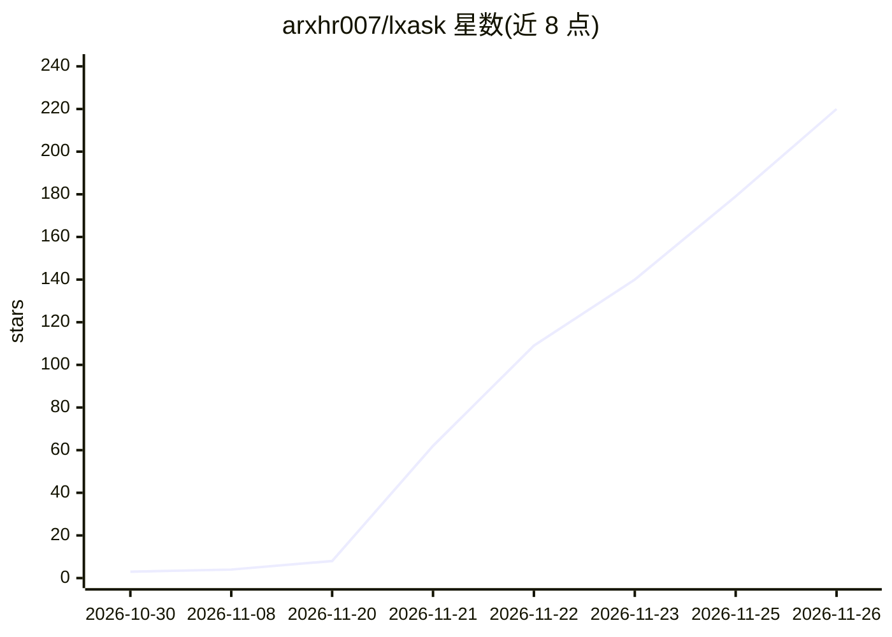

# arxhr007/lxask

⭐ 220 · Python · MIT · 推送 2026-11-25 · [GitHub](https://github.com/arxhr007/lxask) · [官网](https://arxhr007.github.io/lxask/) · 个人维护

**离线 Linux 命令助手：本地 1.5B 模型生成命令并核对文档**

以 Rust 与 llama.cpp 构建的命令行工具，基于 Qwen2.5-Coder-1.5B 经 LoRA 与强化学习微调：用户用自然语言请求，得到可插入命令行的 shell 命令，每条命令对照 man pages 与 tldr 检查，无法确认的部分会标记。安装后离线运行于 CPU，无需网络、账号或 API key；提供 Ctrl+G shell 集成、常驻服务加速、--explain 解释已有命令等模式。README 同时公布基准结果与错误样本。

## 筛选速览

| 维度 | 判定 | 备注 |
|---|---|---|
| AI 角色 | `ai-native` | 本体是模型或模型工具 |
| 许可风险 | `permissive` | MIT |
| 部署形态 | `None` |  |
| 模型依赖 | local-ok | 支持本地模型 |
| 硬件要求 | — | 无带数字的原话,不猜 |
| 安装摩擦 | `low` | 无编译、无系统依赖或容器化 |
| 成熟度 | — | 结构信号不足 |

## 能力要点

- 本地 CPU 运行：约 1.1 GB 磁盘、峰值约 1.3 GB 内存，无需 GPU，加载后约 2 秒出答案
- 每条命令对照 man pages 与 tldr 校验，无法确认的内容被标记
- Ctrl+G 集成 bash/zsh/fish，自然语言行直接转换为命令
- 权重、训练管线、训练数据与评测集全部公开，可复现训练

## 适用场景

- 忘记命令语法时用自然语言直接询问并取回命令
- 受限环境下（如不能使用某工具）生成符合约束的命令
- 解释自己不熟悉的命令各部分含义并做核对
- 无网络或不愿使用云服务的机器上的日常 shell 工作

## 场景标签

`代码生成` · 领域:编码与开发

## 证据(README 行号)

> L6:  A Linux command assistant that runs on your own machine:
> L26: $ lxask "show disk usage of each folder here, biggest first"
> L32: - ✅ **Checks its own work.** Every command is checked against the man pages and tldr, and anything it can't confirm

## 星数曲线

2026-10-30 3 → 2026-11-26 220（+217）

---
*卡片 v1 · prompt 1.4 · 生成 2026-11-20 · 置信度 high · 依据 README sha `b62c94856040` · [字段定义](../../DATASET.md)*
