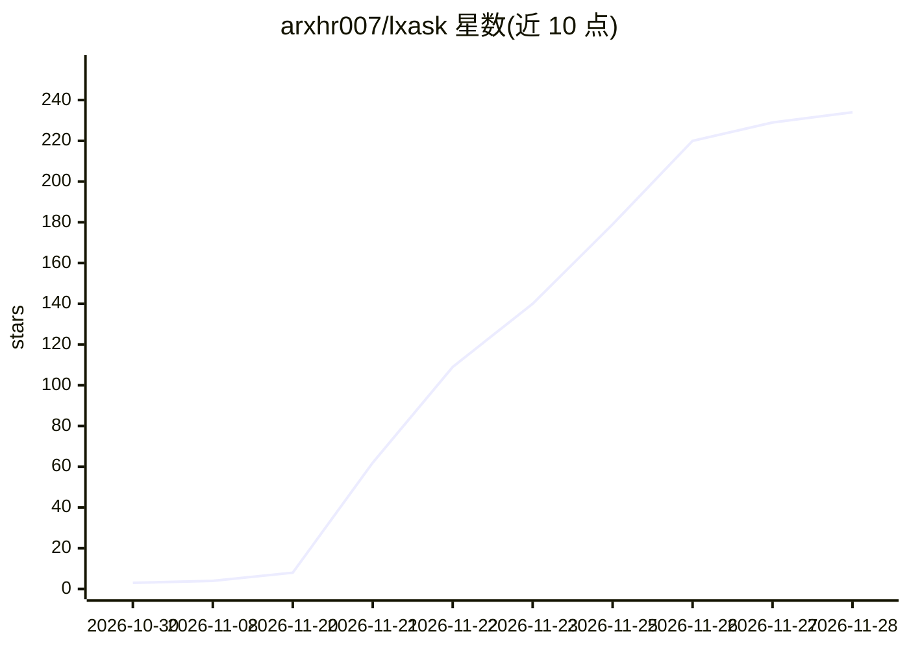

# arxhr007/lxask

⭐ 234 · Python · MIT · 推送 2026-11-26 · [GitHub](https://github.com/arxhr007/lxask) · [官网](https://arxhr007.github.io/lxask/) · 个人维护

**离线 Linux 命令助手：1.5B 本地模型生成并自检 shell 命令**

基于 Qwen2.5-Coder-1.5B（LoRA 微调+沙盒强化学习）的 Linux 命令助手，以 Rust+llama.cpp 在本地 CPU 运行：用自然语言请求即可获得命令，逐部分解释，对输出对照 man pages 与 tldr 校验并标记无法确认之处，可保留“不用 X”类限制、对模糊请求反问。安装约 1.1 GB 磁盘、峰值约 1.3 GB 内存，无需 GPU/网络/API key。提供 Ctrl+G 集成、--command-only 脚本模式与局域网 serve 模式；每日一次后台检查新版本（可关闭）。

## 筛选速览

| 维度 | 判定 | 备注 |
|---|---|---|
| AI 角色 | `ai-native` | 本体是模型或模型工具 |
| 许可风险 | `permissive` | MIT |
| 部署形态 | `None` |  |
| 模型依赖 | local-ok | 支持本地模型 |
| 硬件要求 | — | 无带数字的原话,不猜 |
| 安装摩擦 | `low` | 无编译、无系统依赖或容器化 |
| 成熟度 | — | 结构信号不足 |

## 能力要点

- 本地 CPU 运行的 1.5B 微调模型，无网络/账号/API key
- 命令对照 man pages 与 tldr 校验并标记未确认部分
- 支持“without X”限制保留与模糊请求反问
- Ctrl+G 快捷键、脚本模式与 homelab 局域网 serve

## 适用场景

- 忘记命令时用自然语言问一条并解释
- 无网络环境（服务器/容器）生成 Linux 命令
- 要求“不用某个工具”的替代命令方案
- 解释已有命令的每一部分含义

## 场景标签

`代码生成` · 领域:编码与开发

## 证据(README 行号)

> L6:  A Linux command assistant that runs on your own machine:
> L17:  Qwen2.5-Coder-1.5B
> L30: - 🔒 **Private and offline.** Everything runs locally on your CPU. Nothing you ask leaves your machine.

## 星数曲线

2026-10-30 3 → 2026-11-28 234（+231）

---
*卡片 v1 · prompt 1.4 · 生成 2026-11-28 · 置信度 high · 依据 README sha `edbf731aed8e` · [字段定义](../../DATASET.md)*
