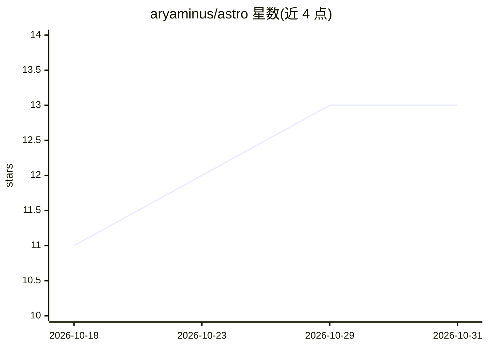

# aryaminus/astro

⭐ 13 · Python · NOASSERTION · 推送 2026-06-08 · [GitHub](https://github.com/aryaminus/astro) · [官网](https://astro-api-a2rc.onrender.com) · 个人维护 · 中文 README

**面向 AI agent 的多体系占星计算 MCP 服务器与 Agent Skill**

为 Claude、ChatGPT、Cursor 等 AI 平台提供占星计算的引擎与接入层：确定性零依赖 Python 引擎计算本命盘、行运、合盘、占星地图等 19 种模式，覆盖西洋、印度 Jyotish 与中国八字三体系；通过 MCP、REST（31 端点）、CLI、ChatGPT Action 等方式接入，模型读取结构化输出并按 8 套经典规则集解读。支持 npx/git clone 本地安装、Docker 与 Render 云端部署，提供免认证的公共实例。

## 筛选速览

| 维度 | 判定 | 备注 |
|---|---|---|
| AI 角色 | `ai-ecosystem` | LLM/agent 周边工具 |
| 许可风险 | `none` | NOASSERTION |
| 部署形态 | `self-host` | docker 或自建部署 |
| 模型依赖 | locked-api |  |
| 硬件要求 | — | 无带数字的原话,不猜 |
| 安装摩擦 | `low` | 无编译、无系统依赖或容器化 |
| 成熟度 | — | 结构信号不足 |

## 能力要点

- 确定性纯标准库 Python 引擎，19 种模式、3 种占星体系
- 18 个 MCP 工具、31 个 REST 端点、ChatGPT Action 接入
- 支持 50+ Agent Skills 宿主的 npx 一键安装
- 可 Docker 自托管或使用免费 Render 云端实例

## 适用场景

- 给 Claude/Cursor 等 agent 添加可计算真实星盘的占星技能
- 自托管占星 API 供自己的应用调用
- 在 ChatGPT Custom GPT 中通过 Action 获取占星数据

## 场景标签

 · 领域:占星计算/agent 工具

## 证据(README 行号)

> L45: 3. **Glue** — MCP, REST, CLI, ChatGPT Actions reach the engine from any platform
> L51: **Modes:** natal, transit, synastry, compatibility, composite, astrocartography, horary, event, solar/lunar/planeta

## 星数曲线

2026-10-18 11 → 2026-10-31 13（+2）

---
*卡片 v1 · prompt 1.4 · 生成 2026-10-31 · 置信度 high · 依据 README sha `0cf94ec8b7a1` · [字段定义](../../DATASET.md)*
