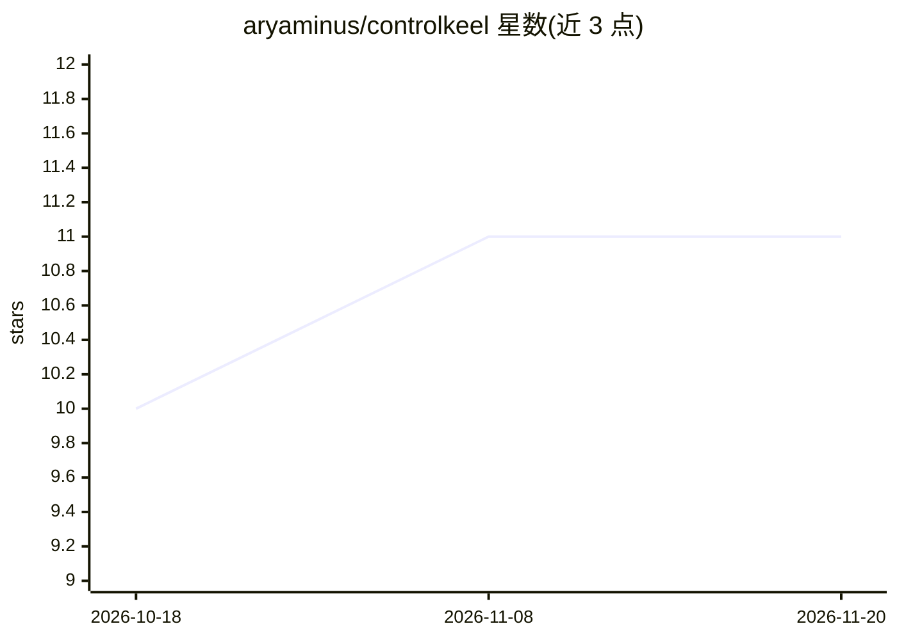

# aryaminus/controlkeel

⭐ 11 · Elixir · NOASSERTION · 推送 2026-11-19 · [GitHub](https://github.com/aryaminus/controlkeel) · [官网](https://controlkeel.com) · 个人维护

**给 AI 编码 agent 提供治理控制面：校验输出、执行策略门禁**

一个面向日常治理化工程的 agent 控制面：通过观察、发现与评估，将团队的意图规则、审查口味与交付习惯转化为类型化记忆、策略检查与证据包。CK 位于编码 agent 与生产环境之间，比较预期交付与实际交付，对高风险动作引入人工审批门禁，并将 findings、reviews、proofs 等证据持久化。以 CLI 分发（brew/npm/安装脚本），通过 stdio MCP 工具集与宿主 agent 连接，开发栈为 Phoenix + Ecto on SQLite，经 Burrito 打包单二进制。

## 筛选速览

| 维度 | 判定 | 备注 |
|---|---|---|
| AI 角色 | `ai-ecosystem` | LLM/agent 周边工具 |
| 许可风险 | `none` | NOASSERTION |
| 部署形态 | `library` | 以包/库形式分发 |
| 模型依赖 | — | README 未给出锁定关系 |
| 硬件要求 | — | 无带数字的原话,不猜 |
| 安装摩擦 | `low` | 无编译、无系统依赖或容器化 |
| 成熟度 | — | 结构信号不足 |

## 能力要点

- 确定性校验器在风险场景中拦截输出并生成 findings
- 持久化基准引擎（with-vs-without 对照套件与评分定义）
- stdio MCP 全量本地工具集与多宿主 attach/export 机制
- 组织成员、工作区仓库绑定、webhook 与策略集 API 等团队操作功能

## 适用场景

- 为使用 AI 编码 agent 的团队执行策略门禁与输出校验
- 将领域知识沉淀为跨会话的类型化记忆与回归证据
- 对高风险 agent 动作设置人工审批环节

## 场景标签

`代码审查` `模型评测` · 领域:编码与开发

## 证据(README 行号)

> L12: **ControlKeel is an agent control plane for day-to-day governed engineering.** Through observation, findings and ev
> L87: - **Local governance:** CLI, the full local stdio MCP tool set, project binding, host attach/export bundles, scanne

## 星数曲线

2026-10-18 10 → 2026-11-20 11（+1）

---
*卡片 v1 · prompt 1.4 · 生成 2026-11-18 · 置信度 high · 依据 README sha `d80e2b50edbf` · [字段定义](../../DATASET.md)*
