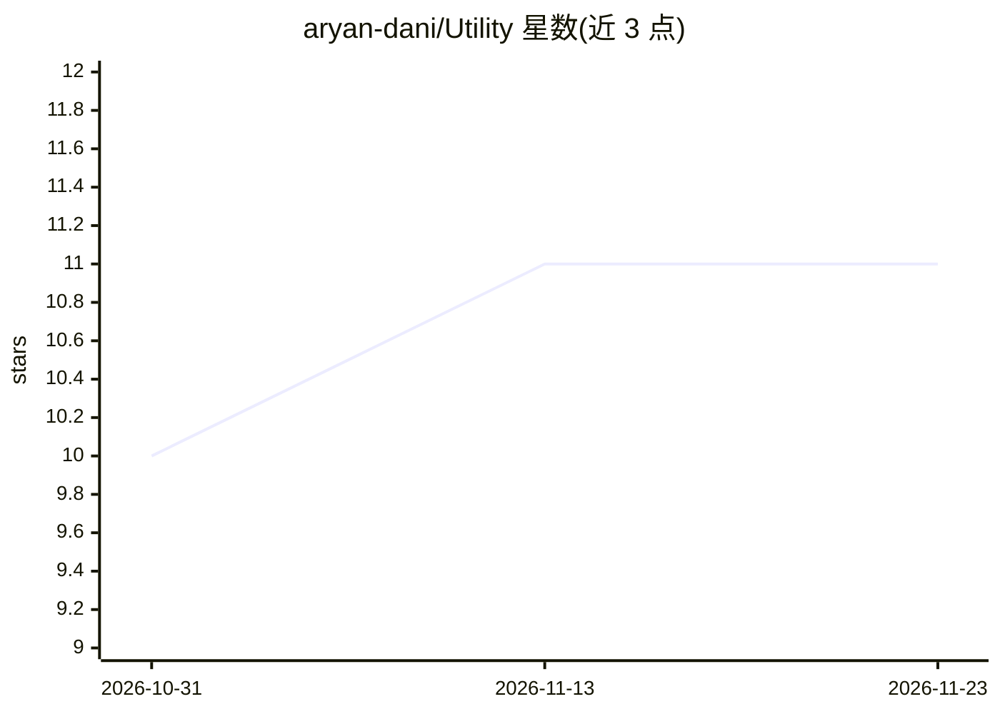

# aryan-dani/Utility

⭐ 11 · TypeScript · NOASSERTION · 推送 2026-11-22 · [GitHub](https://github.com/aryan-dani/Utility) · [官网](https://utilityos.tech) · 个人维护

**大学生学术工作台：笔记库、RAG 学习问答与规划工具**

面向大学生的学术工作空间，将课程资料、日程规划与 AI 学习工具集中在一处。核心机制：基于 BM25 + 向量检索的混合 RAG，按幻灯片分块检索并给出带出处的引用回答，支持按院系/学期限定范围；Google Drive 同步脚本将共享文件夹同步进 Firestore 并建立索引。附带疑问板、SRS 间隔重复卡片、GPA 计算器与番茄钟。需配置 Firebase、Groq、Gemini 等 API 密钥，部署于 Vercel。许可为专有，保留所有权利。

## 筛选速览

| 维度 | 判定 | 备注 |
|---|---|---|
| AI 角色 | `ai-native` | 本体是模型或模型工具 |
| 许可风险 | `none` | NOASSERTION |
| 部署形态 | `library` | 以包/库形式分发 |
| 模型依赖 | locked-api |  |
| 硬件要求 | — | 无带数字的原话,不猜 |
| 安装摩擦 | `low` | 无编译、无系统依赖或容器化 |
| 成熟度 | — | 结构信号不足 |

## 能力要点

- 混合 RAG：BM25 + 向量检索，回答带幻灯片级引用（如 Slide 14 · DBMS.pptx）
- Drive Sync 运行时：Node 脚本将 Google Drive 文件夹同步入 Firestore 并索引文本
- 可安装 PWA 并上架 Microsoft Store（PWABuilder shell，网站部署即自动更新）
- Leitner 式间隔重复闪卡与协作式学习规划器

## 适用场景

- 把课件和笔记集中管理并按学期/科目检索
- 基于自己的课程资料提问并获得带出处的回答
- 和同学协作制定周/月学习计划
- 用间隔重复卡片复习课程知识点

## 场景标签

`知识库管理` `文档问答` · 领域:知识与检索

## 证据(README 行号)

> L3: A premium, monochrome academic workspace for university students. Built with Next.js, Firebase, and Google Drive syn
> L9: - **Document Intelligence (Hybrid RAG)**: Slide-level chunk retrieval with BM25 + vector search, grounded citations 

## 星数曲线

2026-10-31 10 → 2026-11-23 11（+1）

---
*卡片 v1 · prompt 1.4 · 生成 2026-11-19 · 置信度 high · 依据 README sha `8d98d268a97f` · [字段定义](../../DATASET.md)*
