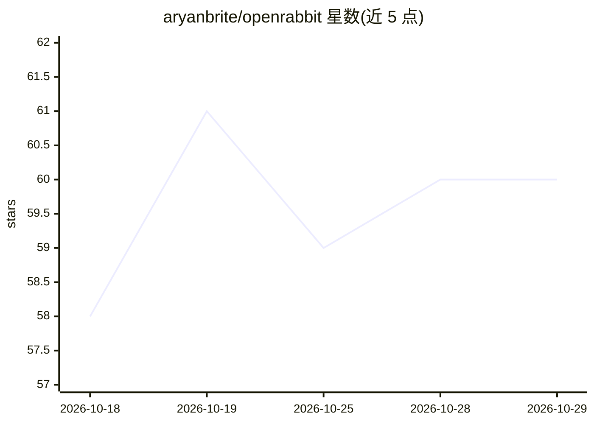

# aryanbrite/openrabbit

⭐ 60 · TypeScript · Apache-2.0 · 推送 2026-09-29 · [GitHub](https://github.com/aryanbrite/openrabbit) · [官网](http://aryan.my/posts/open-rabbit) · 个人维护

**在 GitHub Actions 内自托管的 AI PR 审查工具，免服务器**

开源、自托管的 GitHub Pull Request 审查工具：作为 GitHub Actions 工作流运行，读取 PR diff，调用可插拔的 LLM 提供商（默认使用 OpenRouter 免费模型池并自动轮换模型以规避限流，另支持 Groq 等），输出摘要与行内评论/建议。特色机制包括两阶段文件拉取补充上下文、关联 issue 感知、苏格拉底式导师模式、性能与安全专项检查、建议校验与无关改动（DRIFT）检测。API key 通过 GitHub Actions Secrets 配置，代码不离开用户 runner。

## 筛选速览

| 维度 | 判定 | 备注 |
|---|---|---|
| AI 角色 | `ai-native` | 本体是模型或模型工具 |
| 许可风险 | `permissive` | Apache-2.0 |
| 部署形态 | `None` |  |
| 模型依赖 | locked-api |  |
| 硬件要求 | — | 无带数字的原话,不猜 |
| 安装摩擦 | `low` | 无编译、无系统依赖或容器化 |
| 成熟度 | — | 结构信号不足 |

## 能力要点

- 完全运行在用户自己的 GitHub Actions 环境，无需服务器与订阅
- 可插拔 LLM 提供商，默认 OpenRouter 免费模型池并自动轮换规避限流
- 两阶段文件拉取与关联 issue 感知补充 PR 上下文
- 安全/性能专项审查、建议校验与无关改动（DRIFT）检测

## 适用场景

- 在自己仓库的 CI 里自动生成 PR 结构化审查评论
- 不把代码发给第三方服务的前提下使用 AI 代码审查
- 用免费 OpenRouter 模型池零成本试用 AI 审查

## 场景标签

`代码审查` · 领域:编码与开发

## 证据(README 行号)

> L12: OpenRabbit is a free (you can even get a free llm api explained below), open-source, self-hosted GitHub Pull Reques
> L16: You don't need to pay for a subscription or manage a server. OpenRabbit runs **completely** on your own GitHub Acti

## 星数曲线

2026-10-18 58 → 2026-10-29 60（+2）

---
*卡片 v1 · prompt 1.4 · 生成 2026-10-24 · 置信度 high · 依据 README sha `8d072ba793f6` · [字段定义](../../DATASET.md)*
