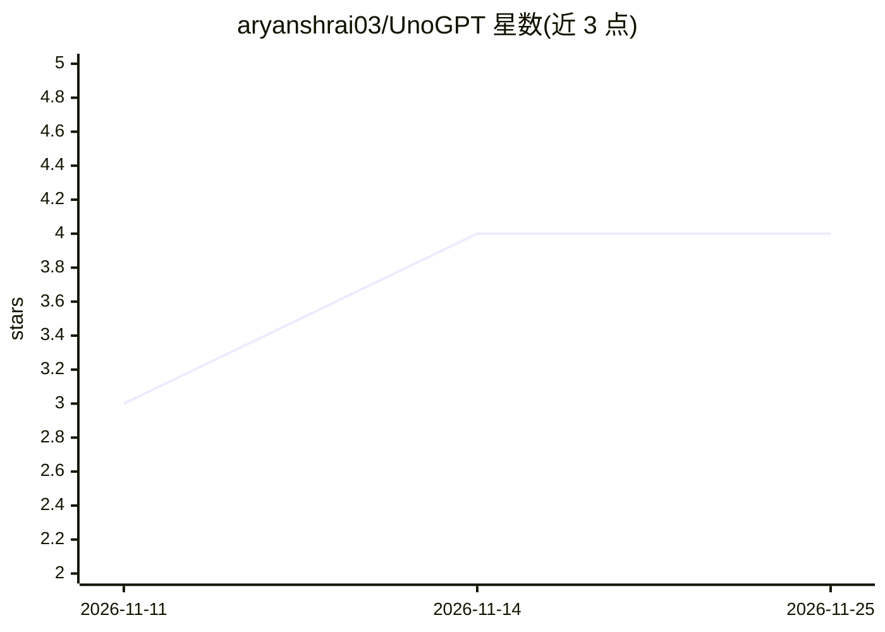

# aryanshrai03/UnoGPT

⭐ 4 · Python · NOASSERTION · 推送 2026-11-10 · [GitHub](https://github.com/aryanshrai03/UnoGPT) · 个人维护

**纯 Python 从零实现的 GPT 算术对话模型**

用纯 Python 标准库实现的 decoder-only transformer：自带反向模式自动微分引擎、字符级 tokenizer、程序化算术对话数据生成器、训练器与采样器，全部代码集中在 unogpt.py（约 3,700 行），零依赖、仅 CPU 运行。面向想逐行阅读真实 GPT 实现的学习者。模型专做算术问答（加减乘除、平方、幂）与简单寒暄，仓库不含预训练权重，需自行训练；nano 配置训练数小时为实用演示，full 配置（5M 参数）需数天至数周。

## 筛选速览

| 维度 | 判定 | 备注 |
|---|---|---|
| AI 角色 | `ai-native` | 本体是模型或模型工具 |
| 许可风险 | `none` | NOASSERTION |
| 部署形态 | `library` | 以包/库形式分发 |
| 模型依赖 | — | README 未给出锁定关系 |
| 硬件要求 | — | 无带数字的原话,不猜 |
| 安装摩擦 | `low` | 无编译、无系统依赖或容器化 |
| 成熟度 | — | 结构信号不足 |

## 能力要点

- 自带反向模式 autodiff 引擎，13 项算子梯度经数值梯度校验
- 零依赖：无需 PyTorch/NumPy/GPU，仅 Python 3.8+ 标准库
- 程序化可复现数据集：97,000 训练样本，6 类算术+寒暄
- KV 缓存采样，支持 temperature/top-k/top-p/重复惩罚

## 适用场景

- 逐行阅读并调试一个真实 GPT 的完整实现
- 学习反向传播与自动微分的原理细节
- 在无 GPU 环境跑通模型训练全流程

## 场景标签

`模型训练` `教程课程` · 领域:学习与行业

## 证据(README 行号)

> L14: UnoGPT is a decoder-only transformer with its own reverse-mode autodiff engine, tokenizer, dataset generator, train
> L16: There is no PyTorch, no NumPy, and no pretrained checkpoint. It's an arithmetic chat model: ask it to add, subtract

## 星数曲线

2026-11-11 3 → 2026-11-25 4（+1）

---
*卡片 v1 · prompt 1.4 · 生成 2026-11-21 · 置信度 mid · 依据 README sha `e32681fe445e` · [字段定义](../../DATASET.md)*
