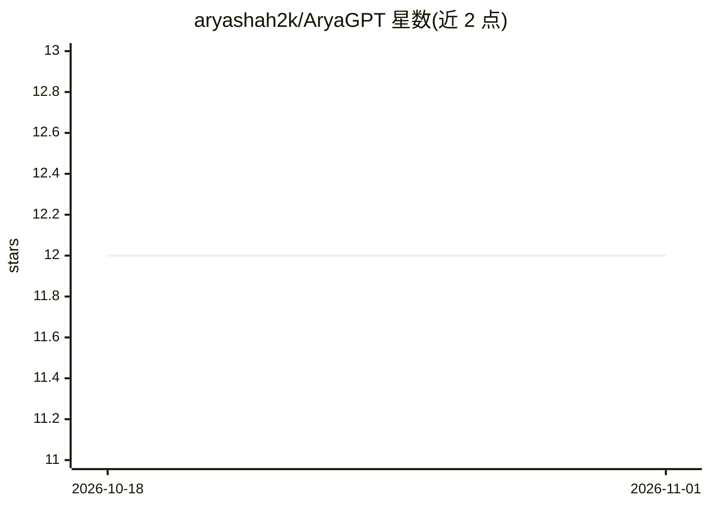

# aryashah2k/AryaGPT

⭐ 12 · Python · 推送 2026-03-04 · [GitHub](https://github.com/aryashah2k/AryaGPT) · [官网](https://aryagpt.streamlit.app) · 个人维护

**回答简历问题的个人 AI 问答 Web 应用**

基于 Streamlit 的个人 AI 助手 Web 应用：用 LangGraph 构建 agent（含知识库检索、Arya 范围内网络搜索、GitHub 活动、摘要等 8 个工具），ChromaDB 存储知识库，本地 all-MiniLM-L6-v2 嵌入加 cross-encoder 重排（嵌入无需 API key），LLM 可在 Groq、Together AI、OpenAI 间切换。支持推送文件到 data/ 后由 GitHub Action 自动重建索引并重新部署，带密码门控管理面板与延迟评估面板。面向想要类似个人简历问答站点的开发者自部署。

## 筛选速览

| 维度 | 判定 | 备注 |
|---|---|---|
| AI 角色 | `ai-native` | 本体是模型或模型工具 |
| 许可风险 | `none` | — |
| 部署形态 | `library` | 以包/库形式分发 |
| 模型依赖 | locked-api |  |
| 硬件要求 | — | 无带数字的原话,不猜 |
| 安装摩擦 | `low` | 无编译、无系统依赖或容器化 |
| 成熟度 | — | 结构信号不足 |

## 能力要点

- LangGraph agent 含 8 个工具（检索/网络搜索/摘要等）
- 本地嵌入 all-MiniLM-L6-v2 + cross-encoder 重排，嵌入无需 API key
- Groq/Together AI/OpenAI 多供应商可经管理面板在线切换
- GitHub Action 自动重建 ChromaDB 并重新部署 Streamlit

## 适用场景

- 搭建个人简历/资料问答网站
- 部署可自动更新知识库的个人 AI 助手
- 对比不同 LLM 供应商的问答延迟与效果

## 场景标签

`AI 助手` `文档问答` · 领域:对话与助手

## 证据(README 行号)

> L3: An agentic, self-updating personal AI assistant that answers questions about **Arya Shah** — built with LangGraph, C
> L7: - **Agentic RAG** — LangGraph agent with 8 tools: knowledge-base retrieval, web search (DuckDuckGo, Arya-scoped), Gi

## 星数曲线

2026-10-18 12 → 2026-11-01 12（+0）

---
*卡片 v1 · prompt 1.4 · 生成 2026-11-01 · 置信度 high · 依据 README sha `97055e8eb92b` · [字段定义](../../DATASET.md)*
