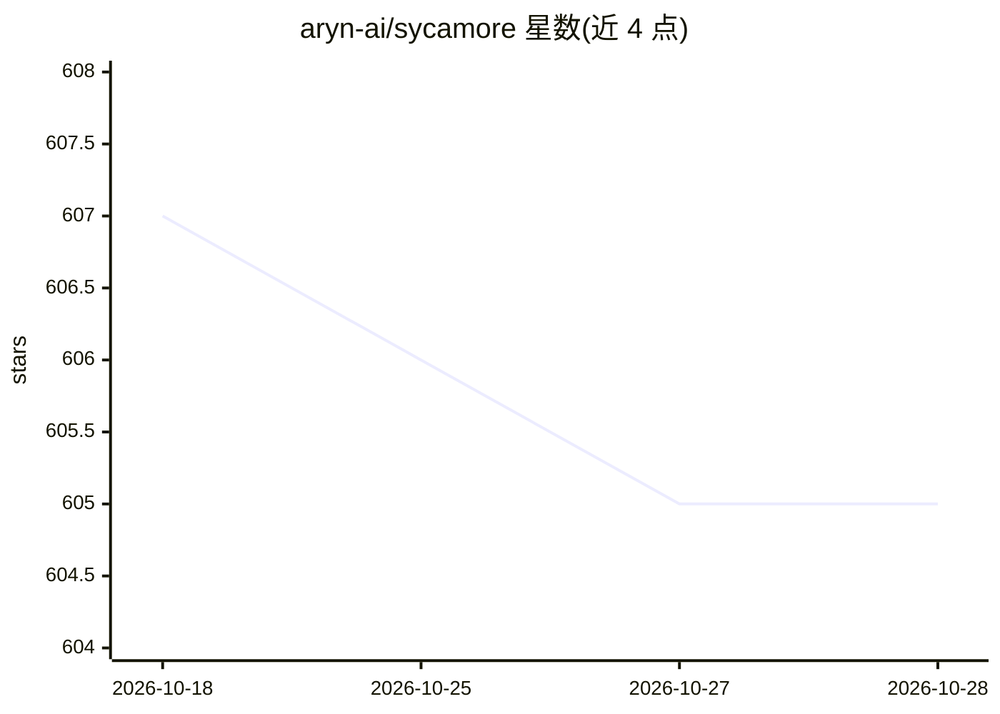

# aryn-ai/sycamore

⭐ 605 · Python · Apache-2.0 · 推送 2026-08-01 · [GitHub](https://github.com/aryn-ai/sycamore) · [官网](https://sycamore.readthedocs.io) · 组织维护

**面向非结构化数据的 LLM 文档处理引擎，服务 ETL/RAG 与分析**

开源的 AI 文档处理引擎，用于对 PDF、图像、报告、演示文稿、转录稿等非结构化文档做分区、富化、清洗与加载，支撑 ETL、RAG、LLM 应用与分析场景。核心抽象为 DocSet，提供 Python 高层转换接口，基于 Ray 后端做可扩展处理。文档分割与 OCR 依赖 Aryn DocParse 服务（DETR 视觉模型，可注册 API key 或本地运行 Aryn Partitioner），支持对接 OpenSearch、ElasticSearch、Pinecone、DuckDB、Qdrant、Weaviate 等向量库与混合搜索引擎。以 pip 包形式安装，运行于 Linux 与 macOS。

## 筛选速览

| 维度 | 判定 | 备注 |
|---|---|---|
| AI 角色 | `ai-ecosystem` | LLM/agent 周边工具 |
| 许可风险 | `permissive` | Apache-2.0 |
| 部署形态 | `library` | 以包/库形式分发 |
| 模型依赖 | — | README 未给出锁定关系 |
| 硬件要求 | — | 无带数字的原话,不猜 |
| 安装摩擦 | `low` | 无编译、无系统依赖或容器化 |
| 成熟度 | — | 结构信号不足 |

## 能力要点

- DocSet 抽象支持文档的分区、富化、转换与清洗
- 集成 Aryn DocParse（DETR 模型）做分割、OCR 与表格提取
- 提供 OpenSearch/ElasticSearch/Pinecone/DuckDB/Qdrant/Weaviate 连接器
- Ray 后端支持可扩展数据处理，含 S3/HTTP 数据爬取

## 适用场景

- 为 RAG 系统做高质量文档解析、分块与向量库装载
- 对含表格、图表的 PDF 等复杂文档做 ETL 处理
- 构建面向非结构化数据的搜索与分析管道

## 场景标签

`文档解析` `RAG` · 领域:知识与检索

## 证据(README 行号)

> L10: Sycamore is an open source, AI-powered document processing engine for ETL, RAG, LLM-based applications, and analyti
> L18: The Sycamore framework is built around a scalable and robust abstraction for document processing called a DocSet, a

## 星数曲线

2026-10-18 607 → 2026-10-28 605（-2）

---
*卡片 v1 · prompt 1.4 · 生成 2026-10-21 · 置信度 high · 依据 README sha `93779f8d3e37` · [字段定义](../../DATASET.md)*
