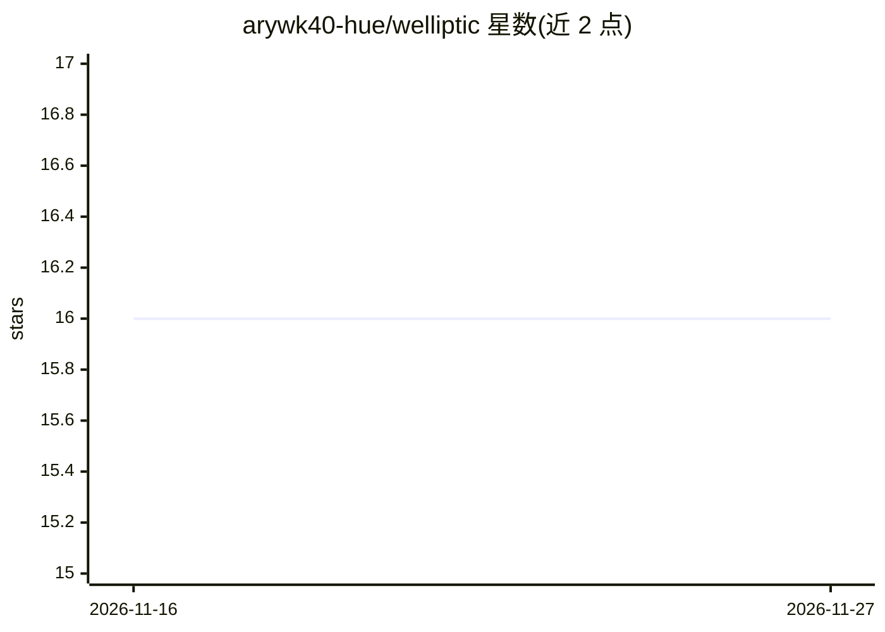

# arywk40-hue/welliptic

⭐ 16 · Python · 推送 2026-03-12 · [GitHub](https://github.com/arywk40-hue/welliptic) · 组织维护

**带人工审批门与链上审计的 AI 合同审查代理**

Weilliptic Hackathon 2026 参赛项目。LexAudit 是一个法律合同审查 agent 流水线：通过 MCP 调用部署在 Weilchain 链上的 Rust WASM applet（ClauseExtractor 条款抽取、RiskScorer 风险分级），每个步骤同时写入本地 JSONL 与链上交易形成双重审计轨迹；高风险条款触发 human-in-the-loop 审批门（默认 HIGH 暂停等待人工批准/驳回，决定也记录上链）。提供 Next.js UI、Neural Console、CLI 三种使用方式，链上 SDK 不可用时有输出一致的本地回退客户端。需 Python 3.11+、Rust wasm32 工具链、Node 18+，配置 ANTHROPIC_API_KEY 与 Weilchain 节点/钱包。

## 筛选速览

| 维度 | 判定 | 备注 |
|---|---|---|
| AI 角色 | `ai-native` | 本体是模型或模型工具 |
| 许可风险 | `none` | — |
| 部署形态 | `None` |  |
| 模型依赖 | — | README 未给出锁定关系 |
| 硬件要求 | — | 无带数字的原话,不猜 |
| 安装摩擦 | `low` | 无编译、无系统依赖或容器化 |
| 成熟度 | — | 结构信号不足 |

## 能力要点

- 每个 agent 步骤产生本地 JSONL + 链上交易的双重审计轨迹
- 高风险条款触发 human-in-the-loop 审批门，人工决定上链记录
- 条款抽取与风险分级由 Weilchain 上的 Rust WASM applet（WIDL 接口）执行
- 链上不可达时 LocalFallbackMCPClient 可离线运行完整流水线

## 适用场景

- 上传合同自动抽取条款并按 LOW/MEDIUM/HIGH 分级
- 高风险合同在人工审批后才放行
- 以链上不可篡改记录留存合同审查全过程

## 场景标签

`文档问答` · 领域:知识与检索

## 证据(README 行号)

> L5: LexAudit is an AI-powered legal contract review agent that extracts clauses, scores risks, enforces a human-in-the-l
> L24: |3|**EXTRACT_CLAUSES**|MCP call to `ClauseExtractor` applet → returns structured clauses|

## 星数曲线

2026-11-16 16 → 2026-11-27 16（+0）

---
*卡片 v1 · prompt 1.4 · 生成 2026-11-18 · 置信度 high · 依据 README sha `a4dbc587812b` · [字段定义](../../DATASET.md)*
