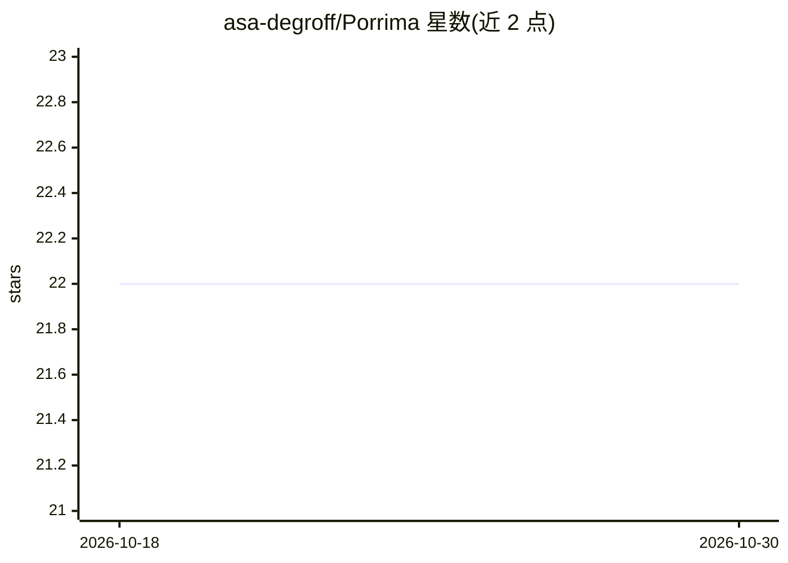

# asa-degroff/Porrima

⭐ 22 · TypeScript · Apache-2.0 · 推送 2026-10-26 · [GitHub](https://github.com/asa-degroff/Porrima) · [官网](https://porrima.cc) · 个人维护

**自托管记忆原生 AI agent 框架与跨平台 GUI 应用**

自托管、带持久记忆的 AI agent 框架，配 PWA 客户端（桌面/平板/移动）。运行时并行驱动两个 llama.cpp 模型：主 agent 与后台记忆提取模型，形成原子记忆向量库、自管理记忆块与定期综合周期。管理五个 llama.cpp 实例槽位（对话/提取/标题/重排/嵌入），支持项目作用域聊天、SKILL.md 技能、TTS、网页访问、KV-cache 感知与快照备份。服务端推荐 Linux + ≥32GB VRAM GPU；安装可由编码 agent 执行或 npm 源码运行。

## 筛选速览

| 维度 | 判定 | 备注 |
|---|---|---|
| AI 角色 | `ai-native` | 本体是模型或模型工具 |
| 许可风险 | `permissive` | Apache-2.0 |
| 部署形态 | `library` | 以包/库形式分发 |
| 模型依赖 | — | README 未给出锁定关系 |
| 硬件要求 | `gpu-24g` | |
| 安装摩擦 | `low` | 无编译、无系统依赖或容器化 |
| 成熟度 | — | 结构信号不足 |

## 能力要点

- 双模型并行：主 agent + 后台记忆提取，原子记忆带向量嵌入
- 五个可配置 llama.cpp 实例槽位，支持自带 GGUF 与热切换
- PWA 客户端覆盖桌面/移动，含记忆库与模型统计可观测面板
- KV-cache 友好 harness：上下文压缩至约 30% 并保持对话尾部完整

## 适用场景

- 在自有硬件上运行带长期记忆的私人 AI agent
- 跨设备通过 PWA 访问自托管 agent 并接收推送
- 在项目工作目录作用域内使用带记忆的编程/工作 agent

## 场景标签

`Agent 框架` `Agent 记忆` `AI 助手` · 领域:Agent 开发

## 证据(README 行号)

> L5: A self-hosted, memory-native AI agent framework and cross-platform GUI application. Persistent agent for private com
> L23: Porrima remembers and recalls its experiences both at runtime with both 'system 1' and 'system 2' memory. It runs t
> L30: Five managed llama.cpp server instances are configurable from the settings menu. Bring your own binaries (mainline 

## 星数曲线

2026-10-18 22 → 2026-10-30 22（+0）

---
*卡片 v1 · prompt 1.4 · 生成 2026-10-27 · 置信度 high · 依据 README sha `34992fdf2551` · [字段定义](../../DATASET.md)*
