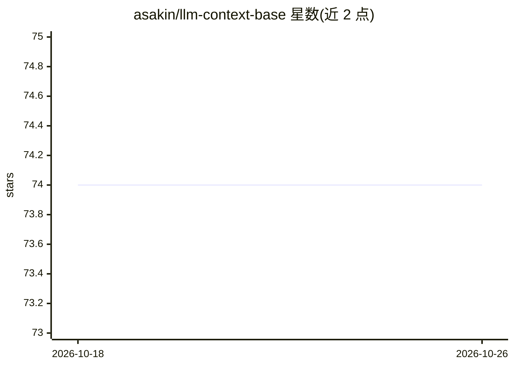

# asakin/llm-context-base

⭐ 74 · Python · Apache-2.0 · 推送 2026-10-25 · [GitHub](https://github.com/asakin/llm-context-base) · 个人维护

**构建个人 LLM Wiki 的 Git 模板：捕获、整理、查询笔记**

基于 Karpathy LLM Wiki 三层模式（原始文档→LLM 维护的 wiki→schema 配置）实现的可直接克隆使用的 Git 模板。每个文件带可查询的元数据头（类型/摘要/标签/状态/日期），LLM 扫描摘要而非加载全文。包含 7 天 TTL 的 Inbox 捕获区、30 天训练期（AI 逐步学习用户习惯）、lint 检查（过期文件/缺失元数据/孤儿文档），以及 Claude Code、Cursor、Copilot、Windsurf、ChatGPT 等工具的接入 shim。配合 Obsidian 作为 vault 使用，也可用任意编辑器。Apache 2.0 许可。

## 筛选速览

| 维度 | 判定 | 备注 |
|---|---|---|
| AI 角色 | `ai-ecosystem` | LLM/agent 周边工具 |
| 许可风险 | `permissive` | Apache-2.0 |
| 部署形态 | `None` |  |
| 模型依赖 | — | README 未给出锁定关系 |
| 硬件要求 | — | 无带数字的原话,不猜 |
| 安装摩擦 | `low` | 无编译、无系统依赖或容器化 |
| 成熟度 | — | 结构信号不足 |

## 能力要点

- 每文件元数据头（type/summary/tags/status/date），LLM 扫描摘要即可查询，可扩展到数百文档
- Inbox-first 捕获区（7 天 TTL），先记录后由 LLM 归档
- 30 天训练期：AI 从提问学习逐步转为安静自适应
- 多 LLM 工具支持：Claude Code、Cursor、Copilot、Windsurf、ChatGPT 等 bootstrap shim

## 适用场景

- 用 AI 助手维护个人/团队知识库而无需预先设计目录结构
- 以对话方式捕获笔记、决策记录并自动归档
- 对已有 wiki 做 lint 检查，发现过期与缺失元数据的文件

## 场景标签

`知识库管理` · 领域:知识与检索

## 证据(README 行号)

> L15: llm-context-base implements this pattern as a ready-to-use template — so you don't have to build it from scratch. W
> L21: - **Multi-LLM support** — bootstrap shims for Claude Code, Cursor, Copilot, Windsurf, and others. One config, any t

## 星数曲线

2026-10-18 74 → 2026-10-26 74（+0）

---
*卡片 v1 · prompt 1.4 · 生成 2026-10-24 · 置信度 high · 依据 README sha `bd348d214e43` · [字段定义](../../DATASET.md)*
