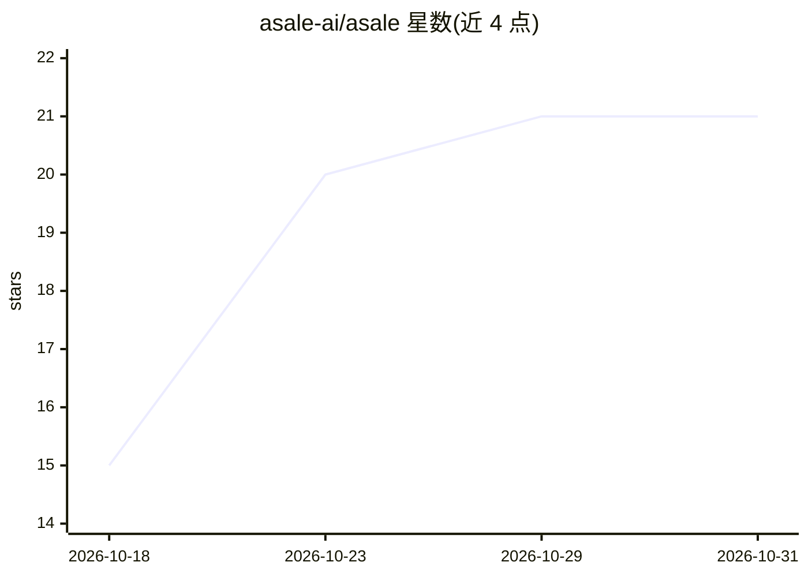

# asale-ai/asale

⭐ 21 · Rust · Apache-2.0 · 推送 2026-10-30 · [GitHub](https://github.com/asale-ai/asale) · [官网](https://asale.ai) · 组织维护 · 中文 README

**AI 订阅额度共享网络桌面客户端：出售闲置额度或代付购量**

Asale 代币共享网络的桌面客户端（Rust/Tauri），连接订阅额度持有者与限额用户：卖家把 Claude Pro/Max、ChatGPT/Codex、Gemini、Kimi、Grok 五类订阅的闲置额度挂到市场，按 USDT（TRC20）每分钟结算获得收入；买家将本地 AI CLI（Claude Code/Codex/Gemini CLI）的配置改指向 Asale，以低于官方 API 的价格使用他人额度。凭据存于 OS 钥匙串不离开本机，平台仅做匹配、转发与计费；不存储对话内容，但中继请求体对提供额度的客户端可见。提供 macOS/Windows/Linux 安装包与无头服务模式。

## 筛选速览

| 维度 | 判定 | 备注 |
|---|---|---|
| AI 角色 | `ai-ecosystem` | LLM/agent 周边工具 |
| 许可风险 | `permissive` | Apache-2.0 |
| 部署形态 | `desktop` | 安装包/桌面程序 |
| 模型依赖 | locked-api |  |
| 硬件要求 | — | 无带数字的原话,不猜 |
| 安装摩擦 | `low` | 无编译、无系统依赖或容器化 |
| 成熟度 | `idea` | |

## 能力要点

- 支持五类订阅（Claude/ChatGPT/Gemini/Kimi/Grok）额度出售与购买
- 凭据存入 OS 钥匙串，数据库仅存引用，凭据不离开本机
- 一键切换 AI CLI 配置指向 Asale，关闭时恢复原始备份文件
- 按自用/买入/卖出三轴统计用量，买卖双方记录可交叉核对费率

## 适用场景

- 把用不完的 AI 订阅额度挂售换取 USDT 收入
- 限额时临时购买他人额度继续使用 AI CLI
- 在服务器无图形环境下以 Web 模式运行客户端

## 场景标签

 · 领域:AI 服务代理/共享经济

## 证据(README 行号)

> L30: **Asale is a token sharing network** that connects those two facts:
> L34: - **Buy** — point your AI CLI at Asale and run on someone else's idle quota, below the
> L70: ### Buy · route your local AI CLIs through Asale

## 星数曲线

2026-10-18 15 → 2026-10-31 21（+6）

---
*卡片 v1 · prompt 1.4 · 生成 2026-10-28 · 置信度 mid · 依据 README sha `7d3ba6026340` · [字段定义](../../DATASET.md)*
