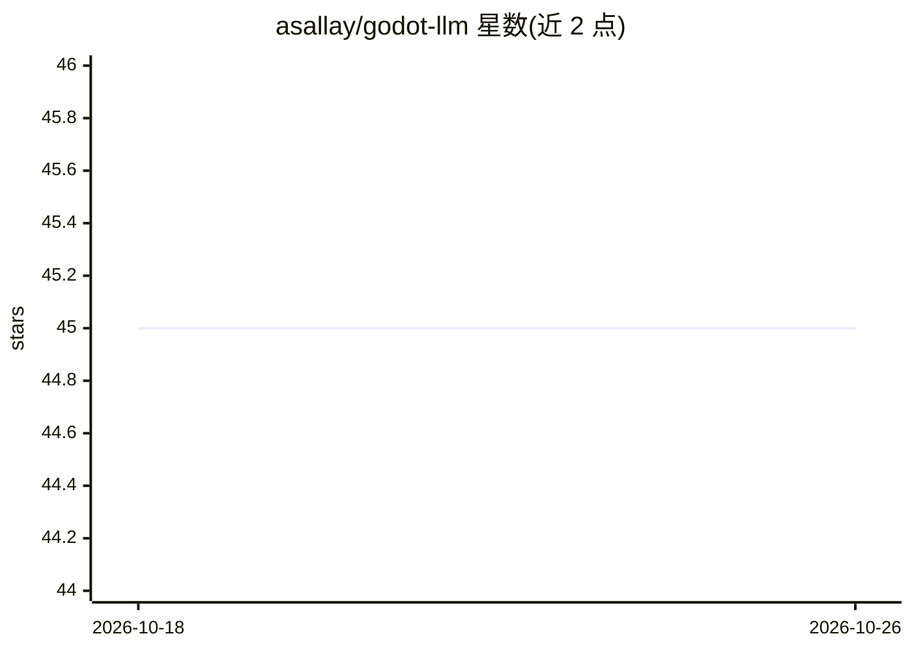

# asallay/godot-llm

⭐ 45 · GDScript · 推送 2026-07-12 · [GitHub](https://github.com/asallay/godot-llm) · 个人维护

**在 Godot 引擎内直接跑 Gemma 推理的实验项目**

Godot 4.7 实验项目：不依赖外部推理进程或原生扩展，仅用 GDScript 与 Vulkan 计算着色器运行单一模型 gemma-4-E2B-it-Q4_K_M.gguf 的文本生成。GDScript 负责 GGUF 元数据解析、分词器、采样、缓存与聊天 UI，transformer 前向在计算着色器中执行，支持量化权重、KV 缓存、prompt 缓存与分组查询注意力。README 声明其速度比 llama.cpp 等真实推理栈慢约一个数量级，模型路径固定不可在运行时覆盖，仅面向实验用途。

## 筛选速览

| 维度 | 判定 | 备注 |
|---|---|---|
| AI 角色 | `ai-native` | 本体是模型或模型工具 |
| 许可风险 | `none` | — |
| 部署形态 | `desktop` | 安装包/桌面程序 |
| 模型依赖 | — | README 未给出锁定关系 |
| 硬件要求 | — | 无带数字的原话,不猜 |
| 安装摩擦 | `medium` | 含编译或系统依赖之一 |
| 成熟度 | `idea` | |

## 能力要点

- 纯 GDScript + Vulkan 计算着色器实现 LLM 推理，无外部进程或原生扩展
- 自行实现 GGUF 解析、分词器、采样（temperature/top-k/top-p）与 KV 缓存
- 仅支持唯一模型 gemma-4-E2B-it-Q4_K_M.gguf，实现针对该模型张量与注意力布局特化
- 附带基准脚本，输出 prefill/生成耗时指标并校验参考 token 序列

## 适用场景

- 在 Godot 游戏内直接运行本地小模型聊天界面做实验
- 学习 LLM 推理流程（量化、注意力、KV 缓存）在计算着色器中的实现
- 探索 Godot RenderingDevice 做通用 GPU 计算的可行性

## 场景标签

`推理引擎` · 领域:训练与推理

## 证据(README 行号)

> L4: > This is not a game-ready project. It is an experiment to see whether LLM inference can run directly in Godot witho
> L7: This Godot 4.7 project runs exactly one model: `gemma-4-E2B-it-Q4_K_M.gguf`. The transformer executes in compute sha

## 星数曲线

2026-10-18 45 → 2026-10-26 45（+0）

---
*卡片 v1 · prompt 1.4 · 生成 2026-10-25 · 置信度 high · 依据 README sha `639ccb2f51eb` · [字段定义](../../DATASET.md)*
