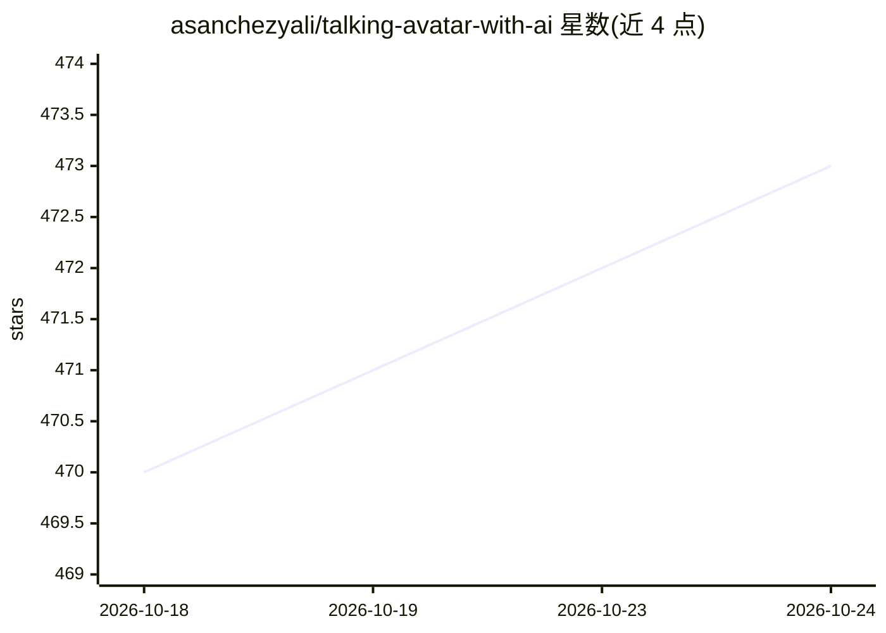

# asanchezyali/talking-avatar-with-ai

⭐ 473 · JavaScript · 推送 2026-09-16 · [GitHub](https://github.com/asanchezyali/talking-avatar-with-ai) · 个人维护

**可对话数字人项目：GPT 生成回答、Whisper 听音、ElevenLabs 发声**

基于 monorepo 的数字人示例项目：文本或语音输入后，经 OpenAI Whisper 转文字、OpenAI GPT 生成带表情与动画指令的结构化回答，再由 Eleven Labs TTS 生成语音、Rhubarb Lip Sync 生成 viseme 实现口型同步，前端在浏览器呈现。面向想搭建会说话虚拟形象的开发者；需要 OpenAI 与 Eleven Labs 订阅（免费版因请求过多出错）、Rhubarb Lip-Sync 与 ffmpeg，通过 git clone 与 yarn 安装运行。

## 筛选速览

| 维度 | 判定 | 备注 |
|---|---|---|
| AI 角色 | `ai-native` | 本体是模型或模型工具 |
| 许可风险 | `permissive` | — |
| 部署形态 | `library` | 以包/库形式分发 |
| 模型依赖 | locked-api |  |
| 硬件要求 | — | 无带数字的原话,不猜 |
| 安装摩擦 | `medium` | 含编译或系统依赖之一 |
| 成熟度 | — | 结构信号不足 |

## 能力要点

- 文本/语音双输入工作流：Whisper 转写→GPT 生成→TTS→口型同步
- 输出结构化指令包含面部表情与身体动画，驱动数字人 Jack
- Rhubarb Lip Sync 生成 viseme 实现音频-口型同步

## 适用场景

- 搭建可语音对话的虚拟形象/数字人演示
- 学习 GPT+TTS+口型同步的集成流水线
- 为客服或展示场景原型化会说话的 3D 角色

## 场景标签

`语音 Agent` `语音识别` `语音合成` · 领域:对话与助手

## 证据(README 行号)

> L12: This project is a digital human that can talk and listen to you. It uses OpenAI's GPT-3 to generate responses, Open
> L60: 2. **Speech-to-Text Conversion:** The audio is transmitted to the OpenAI Whisper API to convert it into text.

## 星数曲线

2026-10-18 470 → 2026-10-24 473（+3）

---
*卡片 v1 · prompt 1.4 · 生成 2026-10-21 · 置信度 high · 依据 README sha `5b25398a36bd` · [字段定义](../../DATASET.md)*
