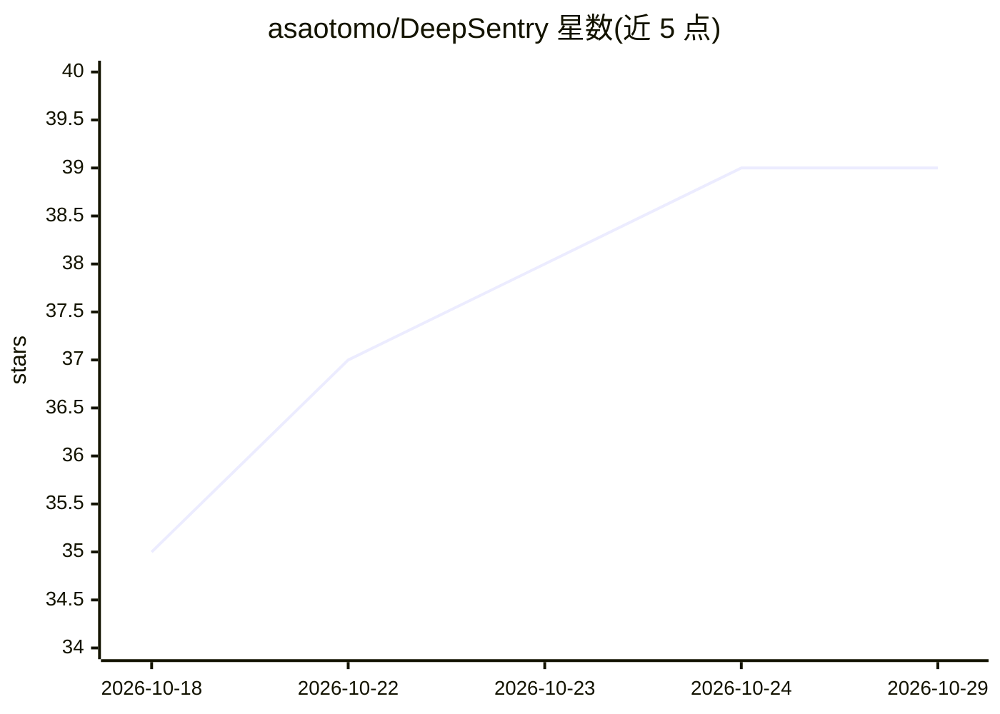

# asaotomo/DeepSentry

⭐ 39 · Go · Apache-2.0 · 推送 2026-10-20 · [GitHub](https://github.com/asaotomo/DeepSentry) · [官网](https://www.hx0.store/products/deepsentry) · 组织维护 · 中文 README

**本地运行的安全应急与智能运维 AI Agent，中文下达安全巡检任务**

用 Go 实现的 AI 安全运维 Agent，以中文任务描述驱动：规划步骤、调用 79 个内置工具，对本地、SSH、Telnet、FTP、Fleet 多主机及 WebShell 场景执行巡检、日志审计、WebShell 排查、暴露面检查与 CTF/AWD 辅助，并生成 Markdown/Word 报告与 SHA256 证据链。可从微信、QQ、飞书、钉钉私聊指挥，适配 DeepSeek 官方 Search 与思考模式，深度对接 Hx0 鹰眼与 FofaMap 的 MCP。需自备大模型 API；要求目标系统已获授权；Linux 桌面功能依赖 X11。

## 筛选速览

| 维度 | 判定 | 备注 |
|---|---|---|
| AI 角色 | `ai-native` | 本体是模型或模型工具 |
| 许可风险 | `permissive` | Apache-2.0 |
| 部署形态 | `desktop` | 安装包/桌面程序 |
| 模型依赖 | local-ok | 支持本地模型 |
| 硬件要求 | — | 无带数字的原话,不猜 |
| 安装摩擦 | `medium` | 含编译或系统依赖之一 |
| 成熟度 | — | 结构信号不足 |

## 能力要点

- 79 个内置工具覆盖主机巡检、日志审计、WebShell 排查、端口与服务探测
- 支持本地/SSH/Telnet/FTP/SFTP/Fleet 多目标与 WebShell 后台执行
- 微信、QQ、企业微信、飞书、钉钉私聊指挥，含验证码回传与高危操作分级确认
- 生成 Markdown/Word 报告并保存 SHA256 串联的可审计证据档案

## 适用场景

- 用一句话让 Agent 排查服务器的系统、端口和登录异常并出报告
- 值班时通过微信/飞书私聊远程指挥巡检任务
- 多台授权主机批量只读巡检与风险汇总
- CTF 初筛与 AWD 比赛中的批量检查、取证和值守

## 场景标签

`网络安全` · 领域:学习与行业

## 证据(README 行号)

> L16: DeepSentry 是一个跑在你自己电脑或服务器上的 **AI 安全应急 / 智能运维 Agent**。用中文说清目标，它会规划步骤、调用工具、连本地或远程主机，并留下可审计的报告。
> L78: 核心能力：中文全屏终端、本地 / SSH / Telnet / FTP / 多主机、79 个内置工具、DeepSeek 联网搜索与三协议思考模式适配、会话恢复、定时任务、聊天机器人、Office/PDF 结构化阅读与生成、对 **

## 星数曲线

2026-10-18 35 → 2026-10-29 39（+4）

---
*卡片 v1 · prompt 1.4 · 生成 2026-10-25 · 置信度 mid · 依据 README sha `c914ec8b6611` · [字段定义](../../DATASET.md)*
