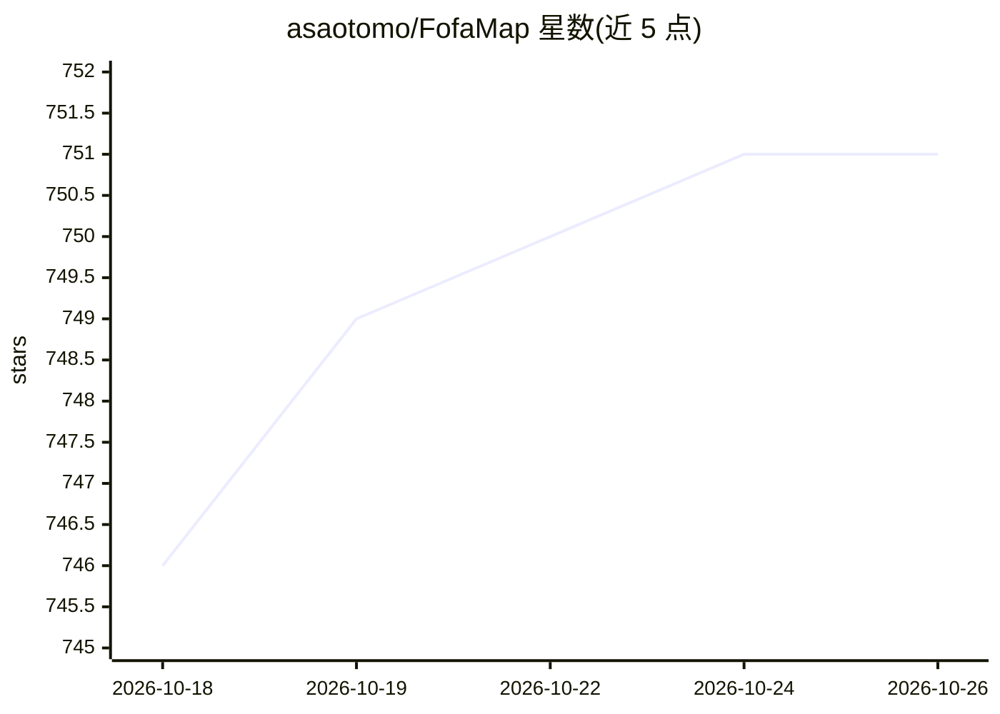

# asaotomo/FofaMap

⭐ 751 · Python · Apache-2.0 · 推送 2026-08-16 · [GitHub](https://github.com/asaotomo/FofaMap) · [官网](https://www.hx0.store/products/fofamap) · 个人维护 · 中文 README

**FOFA 资产测绘智能体：自然语言侦察加证据分级与审批式扫描**

面向安全研究人员与红队/蓝队人员的 FOFA 资产测绘工具：既可作为传统 CLI 直接执行 FOFA 语句（查询、主机画像、统计、图标反查、批量），也可在 -ai 模式下由 Agent 把自然语言需求拆成多组查询、依据命中量反思最多两轮、按证据等级（corroborated/observed/candidate）输出资产简报与 Markdown 报告。支持 MCP/Skill 一键接入 Cursor、Claude Code、Codex 等宿主及 REST API。Nuclei 扫描为可选，方案须一次性令牌审批，-batch 不可绕过；经典查询不需要模型。

## 筛选速览

| 维度 | 判定 | 备注 |
|---|---|---|
| AI 角色 | `ai-native` | 本体是模型或模型工具 |
| 许可风险 | `permissive` | Apache-2.0 |
| 部署形态 | `desktop` | 安装包/桌面程序 |
| 模型依赖 | local-ok | 支持本地模型 |
| 硬件要求 | — | 无带数字的原话,不猜 |
| 安装摩擦 | `low` | 无编译、无系统依赖或容器化 |
| 成熟度 | — | 结构信号不足 |

## 能力要点

- 自然语言规划多组 FOFA 查询并基于命中反思修正（最多两轮）
- 组织网站候选的证据三级分级，不把泛命中写成归属结论
- Nuclei 扫描方案须一次性令牌人工审批，模板与级别精确展示
- MCP/Skill 一键接入 Cursor、Claude Code、Codex、LM Studio 等 9 类宿主

## 适用场景

- 用自然语言做资产测绘并拿到带证据边界的报告
- 已知 FOFA 语法时用 CLI 批量检索导出 XLSX/CSV/JSONL
- 把 FOFA 检索能力以 MCP 工具形式接入我的 AI 宿主

## 场景标签

`网络安全` · 领域:学习与行业

## 证据(README 行号)

> L21: FofaMap 既能像传统 CLI 一样直接执行 FOFA 语句，也能让 Agent 把一句自然语言需求拆成多组查询，依据真实命中自我反思，最后输出带证据边界的资产简报。需要扫描时，它只先生成方案；目标、模板和严重级别必须经过一次
> L424: fofamap -ai '查找授权范围内暴露的 ThinkPHP，按证据等级总结并建议下一步'
> L455: AI 提供商支持 OpenAI、DeepSeek、Anthropic、Ollama、LM Studio 及兼容接口。规划、语法修复、反思和总结可分别路由；跨提供商回退默认关闭。

## 星数曲线

2026-10-18 746 → 2026-10-26 751（+5）

---
*卡片 v1 · prompt 1.4 · 生成 2026-10-21 · 置信度 high · 依据 README sha `c4778f2c43d0` · [字段定义](../../DATASET.md)*
