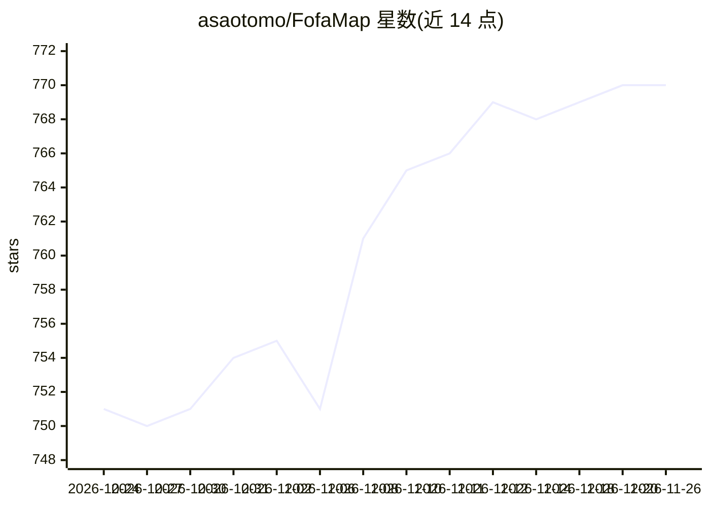

# asaotomo/FofaMap

⭐ 770 · Python · Apache-2.0 · 推送 2026-11-02 · [GitHub](https://github.com/asaotomo/FofaMap) · [官网](https://www.hx0.store/products/fofamap) · 组织维护 · 中文 README

**给安全人员用的AI资产测绘工具：串联FOFA查询、验证与报告**

FofaMap 将 FOFA 资产查询、AI Agent 反思分析、Nuclei 授权扫描与 Markdown/HTML 报告交付整合进同一命令行工作流，覆盖语法入门、字段选择、分页额度控制、CSV/JSONL/XLSX 导出与定时快照对比。普通查询仅需 FOFA API Key，无需配置模型；AI 调查需另配模型 Key。提供 31 个 MCP 工具、Skill 与 REST API 供宿主 AI 助手或程序调用，主动扫描需用户确认方案。

## 筛选速览

| 维度 | 判定 | 备注 |
|---|---|---|
| AI 角色 | `ai-enhanced` | 去掉 AI 部分产品仍成立 |
| 许可风险 | `permissive` | Apache-2.0 |
| 部署形态 | `desktop` | 安装包/桌面程序 |
| 模型依赖 | local-ok | 支持本地模型 |
| 硬件要求 | — | 无带数字的原话,不猜 |
| 安装摩擦 | `low` | 无编译、无系统依赖或容器化 |
| 成熟度 | — | 结构信号不足 |

## 能力要点

- 31 个 MCP 工具 + Skill + REST API 多入口接入
- Agent 规划查询并按命中反思，输出可回看证据的资产简报
- 内置 691 条、166 类本地指纹规则库（含核验状态标记）
- 主动扫描需展示目标与方案并经用户确认

## 适用场景

- 用一句话让 Agent 完成域名资产调查并生成简报
- 对授权范围资产做周期盘点与快照对比
- 在 Codex/Cursor/Claude 等宿主中通过 MCP 调用资产查询
- 导出 CSV/XLSX 资产清单交给团队继续分析

## 场景标签

`网络安全` · 领域:学习与行业

## 证据(README 行号)

> L12: **证据驱动的 AI 资产测绘与安全研判工具。**
> L16: 你可以通过方向键向导快速上手，继续使用经典命令行，或通过 **MCP / Skill / REST API** 接入 AI 助手与自动化流程。**普通查询仅需 FOFA API Key，无需配置模型；主动扫描需经用户确认。**
> L135: |一句话描述，让工具规划和写总结|本地 `-ai` Agent|需要|需要配置模型|
> L139: |主动扫描|上述入口 + Nuclei + 精确方案审批|从 FOFA 取目标时需要|本地确定性扫描不需要|

## 星数曲线

2026-10-24 751 → 2026-11-26 770（+19）

---
*卡片 v1 · prompt 1.4 · 生成 2026-11-24 · 置信度 high · 依据 README sha `d9fa67947442` · [字段定义](../../DATASET.md)*
