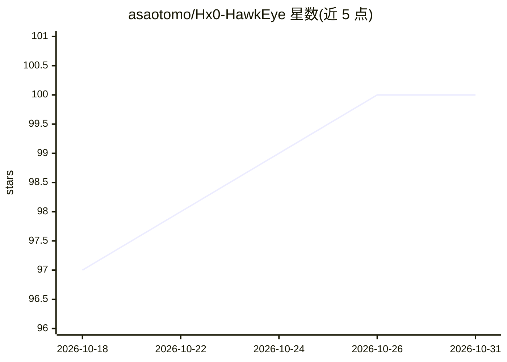

# asaotomo/Hx0-HawkEye

⭐ 100 · 推送 2026-10-14 · [GitHub](https://github.com/asaotomo/Hx0-HawkEye) · [官网](https://www.hx0.store/products/hawkeye) · 个人维护 · 中文 README

**浏览器安全工作台扩展：抓包/拦截/重放/Fuzz 集成 AI 与 MCP**

面向 Chrome/Firefox/Chromium 的轻量级安全工作台浏览器扩展，在真实标签页与登录态中提供抓包（含 WebSocket）、拦截改包、流量重放、三点微型 Fuzz、敏感信息与暗链检测、147 项工具的编解码工作台。AI 能力以 BYOK 方式接入自有模型 API（OpenAI/DeepSeek/Grok/Gemini/Ollama/LM Studio 等），用于 payload 生成、报文解读与智能解码辅助；本地处理优先，推测与已验证结果分开展示。专业版（PRO）另提供浏览器级 Agent、MCP Server 与页面助手。可选 MCP 接入需另行安装 Node.js 18+。

## 筛选速览

| 维度 | 判定 | 备注 |
|---|---|---|
| AI 角色 | `ai-enhanced` | 去掉 AI 部分产品仍成立 |
| 许可风险 | `none` | — |
| 部署形态 | `library` | 以包/库形式分发 |
| 模型依赖 | local-ok | 支持本地模型 |
| 硬件要求 | — | 无带数字的原话,不猜 |
| 安装摩擦 | `low` | 无编译、无系统依赖或容器化 |
| 成熟度 | — | 结构信号不足 |

## 能力要点

- 侧边栏内闭环：抓包→拦截→重放→微型 Fuzz→暗链检测，无需配置系统代理
- BYOK 接入多家模型 API，AI 生成 Payload/用例，密码与私钥不发送给 AI
- 编解码工作台 147 项工具、最多 16 步配方，智能解码 76 条路径本地核验
- PRO 提供浏览器级 Agent、HawkEye MCP（53 项工具）与四个页面助手

## 适用场景

- 日常联调与接口排障时在浏览器内直接抓包、改包、重放
- 授权测试环境中做微型 Fuzz 与敏感信息、暗链初筛
- 通过 MCP 让外部 Agent Host 复用浏览器会话与安全工具
- CTF 与安全分析中的多层编码还原与批量报文归纳

## 场景标签

`网络安全` · 领域:学习与行业

## 证据(README 行号)

> L53: **基础抓包无需配置系统代理。** Hx0 鹰眼是一款面向 Chrome、Firefox 和主流 Chromium 浏览器的轻量级安全工作台。它在用户真实标签页与登录态中统一提供**抓包与拦截改包（含 WebSocket）、流量重
> L62: #### 🤖 杀手锏：全流程 AI 智能赋能 (BYOK)
> L91: |**AI 分析（可选）**|单包分析基于实际捕获的请求/响应证据；批量分析在独立工作台逐条归纳并汇总。AI 任务台支持多阶段任务、Skills 与运行中补充线索。提供 OpenAI、DeepSeek、Grok、MiniMax、G

## 星数曲线

2026-10-18 97 → 2026-10-31 100（+3）

---
*卡片 v1 · prompt 1.4 · 生成 2026-10-23 · 置信度 mid · 依据 README sha `e7166b31c0f9` · [字段定义](../../DATASET.md)*
