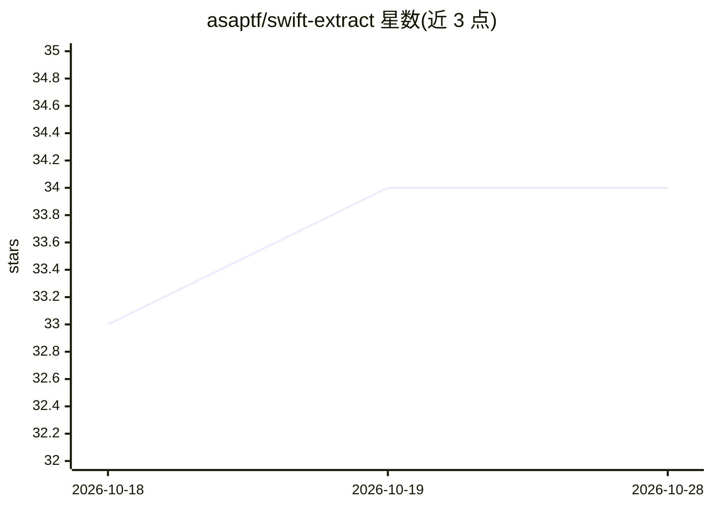

# asaptf/swift-extract

⭐ 34 · Swift · Apache-2.0 · 推送 2026-09-27 · [GitHub](https://github.com/asaptf/swift-extract) · 个人维护

**Swift 结构化提取库：从 PDF/照片/文本经 LLM 输出类型化实例**

面向 iOS/macOS 开发者的 Swift Package（Swift 6.1+，iOS 17+/macOS 14+）：声明一个 @Extractable Swift 类型，即可从 PDF（文本层或扫描）、照片（Vision OCR）或纯文本中提取出经验证的类型化实例。模型后端经 AnyLanguageModel 统一接入：Apple Intelligence、MLX、Core ML、llama.cpp 本地运行，或 OpenAI/Anthropic/Gemini 云端。提供 MRZ 算术校验、Swift 不变量校验与重试、逐字段溯源信号与边界框定位；明确声明非 KYC 产品、无生物识别与防伪检测。支持长文档分块合并与 CLI。

## 筛选速览

| 维度 | 判定 | 备注 |
|---|---|---|
| AI 角色 | `ai-native` | 本体是模型或模型工具 |
| 许可风险 | `permissive` | Apache-2.0 |
| 部署形态 | `None` |  |
| 模型依赖 | local-ok | 支持本地模型 |
| 硬件要求 | — | 无带数字的原话,不猜 |
| 安装摩擦 | `low` | 无编译、无系统依赖或容器化 |
| 成熟度 | — | 结构信号不足 |

## 能力要点

- 返回类型即全部配置：同一入口提取收据、发票、证件、邮件等任意文档
- 逐字段 grounding 信号（verbatim/normalized/absent）与 PDF/OCR 坐标溯源，无置信度分数
- Swift 不变量校验失败回传模型重试，支持 InvariantPolicy 策略选择
- 可选 traits 启用 MLX/Core ML/llama.cpp 本地后端，实现完全离线提取

## 适用场景

- 在 iOS/macOS 应用内离线提取收据、发票等文档为类型化数据
- 敏感证件场景使用本地模型，使图像与个人数据不离开设备
- 构建带字段级溯源与人工复核 UI 的文档处理流程

## 场景标签

`文档解析` · 领域:知识与检索

## 证据(README 行号)

> L3: **Define a Swift type. Point the library at anything — a PDF, a receipt photo, an ID document, a screenshot, or plai
> L5: Powered by any LLM: Apple Intelligence on-device, MLX / Core ML / llama.cpp locally, or OpenAI / Anthropic / Gemini 
> L71: - **Any input.** PDFs (text layer or scanned), photos and screenshots via Vision OCR, and plain

## 星数曲线

2026-10-18 33 → 2026-10-28 34（+1）

---
*卡片 v1 · prompt 1.4 · 生成 2026-10-25 · 置信度 high · 依据 README sha `a8df37b57c9a` · [字段定义](../../DATASET.md)*
