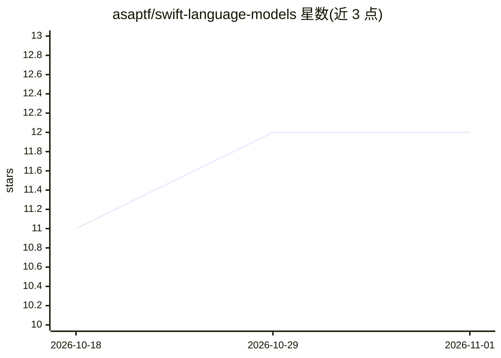

# asaptf/swift-language-models

⭐ 12 · Swift · Apache-2.0 · 推送 2026-08-11 · [GitHub](https://github.com/asaptf/swift-language-models) · [官网](https://www.amazon.com/dp/B0H7BPJLHC) · 个人维护

**纯 Swift 从零实现语言模型的四部曲教程（n-gram→GPT→RAG）**

可运行的教科书式课程仓库：分四部分从零构建语言模型——纯计数 n-gram、手写标量自动微分引擎与神经网络、基于 MLX 的字符级 GPT Transformer（自注意力/多头/AdamW，需 Apple Silicon）、以及基于 BM25 与本地 Llama-2 的完整 RAG 管线。每部分为独立 SwiftPM 包，附 README、分章 TEXTBOOK 与 SVG 图解，配合作者出版的书籍使用。面向想理解 LLM 内部机制的学习者，明确以清晰性优先于性能。

## 筛选速览

| 维度 | 判定 | 备注 |
|---|---|---|
| AI 角色 | `ai-knowledge` | 知识聚合/清单类 |
| 许可风险 | `permissive` | Apache-2.0 |
| 部署形态 | `None` |  |
| 模型依赖 | — | README 未给出锁定关系 |
| 硬件要求 | — | 无带数字的原话,不猜 |
| 安装摩擦 | `medium` | 含编译或系统依赖之一 |
| 成熟度 | — | 结构信号不足 |

## 能力要点

- 四个独立可运行的从零实现：n-gram、autograd、MLX GPT、RAG
- 手写反向传播自动微分引擎并以有限差分验证梯度
- RAG 部分从零构建倒排索引与 BM25，配合本地 Llama-2 推理，无云端无 Python
- 每部分附分章教科书文档与机制图解（SVG）

## 适用场景

- 循序渐进理解 tokenization、backprop、attention、RAG 等 LLM 核心概念
- 在 Apple Silicon 上亲手训练并观察一个字符级 GPT 的过拟合过程
- 对照配套书籍边读机制边跑代码做实验

## 场景标签

`教程课程` · 领域:学习与行业

## 证据(README 行号)

> L3: > A four-part, build-it-yourself course that climbs from *counting letters* all
> L7: This repository is **a textbook you can run**. Each part is a small, complete,

## 星数曲线

2026-10-18 11 → 2026-11-01 12（+1）

---
*卡片 v1 · prompt 1.4 · 生成 2026-11-01 · 置信度 high · 依据 README sha `e9cb33720cdf` · [字段定义](../../DATASET.md)*
