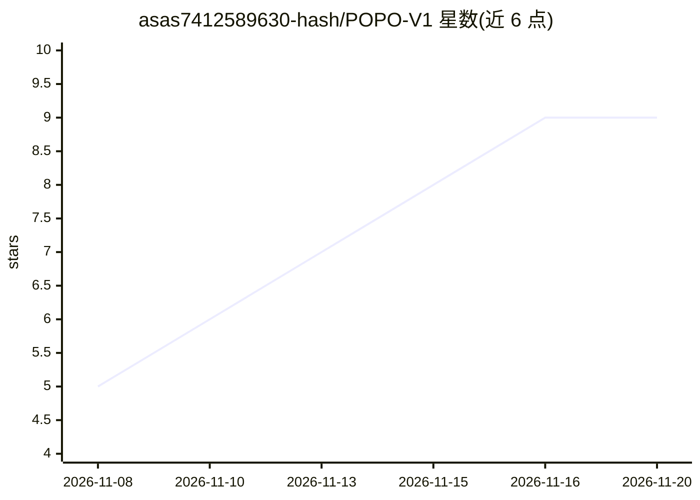

# asas7412589630-hash/POPO-V1

⭐ 9 · Python · NOASSERTION · 推送 2026-11-11 · [GitHub](https://github.com/asas7412589630-hash/POPO-V1) · 个人维护 · 中文 README

**本机自托管的模型 API 閘道，统一多上游为 OpenAI 相容 API**

以纯 Python 标准库实现的模型 API 閘道：用户提供一组上游凭证后，在本机启动 OpenAI Chat Completions 相容端点及 Anthropic Messages 转译，另直通 Images/Embeddings/Audio 端点。通过本机控制台完成上游设定、模型发现与发布、API 金钥管理；内置按模型的提示积木、拒答重试、历史整理与上下文压缩、分回合请求记录。面向需要在本机统一管理与调用多个模型上游的开发者，需 Python 3.10 以上，核心服务无第三方依赖。

## 筛选速览

| 维度 | 判定 | 备注 |
|---|---|---|
| AI 角色 | `ai-ecosystem` | LLM/agent 周边工具 |
| 许可风险 | `none` | NOASSERTION |
| 部署形态 | `None` |  |
| 模型依赖 | — | README 未给出锁定关系 |
| 硬件要求 | — | 无带数字的原话,不猜 |
| 安装摩擦 | `low` | 无编译、无系统依赖或容器化 |
| 成熟度 | — | 结构信号不足 |

## 能力要点

- OpenAI 相容代理与 Anthropic Messages 转译，多上游路由与模型发现
- 按模型的提示积木、拒答重试、历史压缩与折叠等可调机制
- 客户端 API 金钥范围管理（对内/对外）与逐回合审计记录
- 纯 Python 标准库实现，核心服务无第三方套件

## 适用场景

- 在本机把多个上游模型统一暴露为一个 OpenAI 相容 API
- 对客户端请求做拒答重试与上下文整理后转发上游
- 自托管场景下管理 API 金钥并留存请求与用量记录

## 场景标签

`模型网关` · 领域:Agent 开发

## 证据(README 行号)

> L3: POPO 是一個以 Python 標準庫實作的模型 API 閘道。它提供簡化的本機控制台、多上游模型路由、可選的模型提示積木、請求調校與使用紀錄。
> L27: - OpenAI Chat Completions 相容代理，以及 Anthropic Messages 轉譯
> L21: 開啟 http://127.0.0.1:8412/app/，控制台以本機同源方式管理，不需要登入。首次設定依序填入上游 Base URL 和 API Key，讀取模型、勾選要發布的模型及提示積木，選擇新 API 金鑰範圍，再按「套

## 星数曲线

2026-11-08 5 → 2026-11-20 9（+4）

---
*卡片 v1 · prompt 1.4 · 生成 2026-11-20 · 置信度 high · 依据 README sha `641b7e95e5e1` · [字段定义](../../DATASET.md)*
