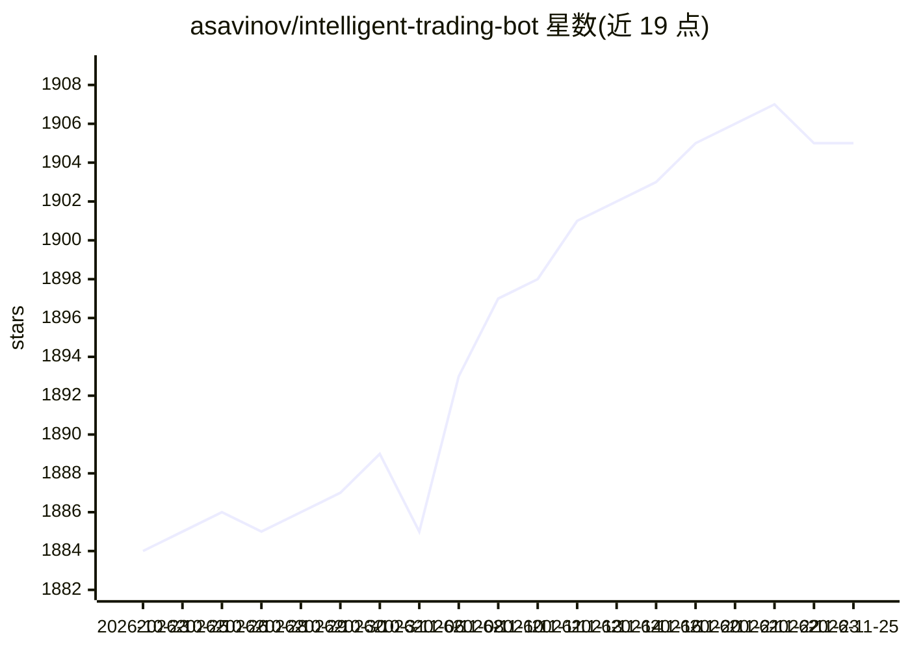

# asavinov/intelligent-trading-bot

⭐ 1,905 · Python · MIT · 推送 2026-11-18 · [GitHub](https://github.com/asavinov/intelligent-trading-bot) · [官网](https://t.me/intelligent_trading_signals) · 个人维护

**用机器学习为加密货币自动生成交易信号的机器人**

面向加密货币等资产的自动化交易机器人，将离线批量模式（训练 ML 模型）与在线流模式（用已训练模型做预测）分离，保证两种模式使用相同的衍生特征。流水线覆盖数据下载与合并、特征生成（talib/tsfresh 等生成器）、标签生成、模型训练、预测聚合为智能指标、信号输出（Telegram/数据库/实际交易）以及历史数据回测。当前示例配置针对 Binance 交易所的 BTCUSDT、1 分钟频率；数据源限于 Binance 与 Yahoo，不可扩展。

## 筛选速览

| 维度 | 判定 | 备注 |
|---|---|---|
| AI 角色 | `ai-native` | 本体是模型或模型工具 |
| 许可风险 | `permissive` | MIT |
| 部署形态 | `None` |  |
| 模型依赖 | — | README 未给出锁定关系 |
| 硬件要求 | — | 无带数字的原话,不猜 |
| 安装摩擦 | `low` | 无编译、无系统依赖或容器化 |
| 成熟度 | — | 结构信号不足 |

## 能力要点

- 离线训练与在线预测双模式共享同一特征定义
- 可扩展的衍生特征生成器（talib、tsfresh、自定义 Python 函数）
- 支持多种交易频率（1 分钟/1 小时/1 天）与含周期性重训练的回测
- 信号可发送至 Telegram、API 端点、数据库或执行真实交易

## 适用场景

- 为 BTCUSDT 等交易对自动生成买卖信号并推送到 Telegram
- 在历史数据上回测含重训练的模型交易表现
- 自定义技术指标特征训练分类/回归预测模型

## 场景标签

`金融量化` · 领域:学习与行业

## 证据(README 行号)

> L12: The aim of the project is to develop an intelligent trading bot for automated trading including cryptocurrencies us
> L106: This script is needed only in batch (offline) mode and its purpose is to analyze historic data and produce ML mode

## 星数曲线

2026-10-23 1,884 → 2026-11-25 1,905（+21）

---
*卡片 v1 · prompt 1.4 · 生成 2026-11-24 · 置信度 high · 依据 README sha `8a1f5d44bf54` · [字段定义](../../DATASET.md)*
