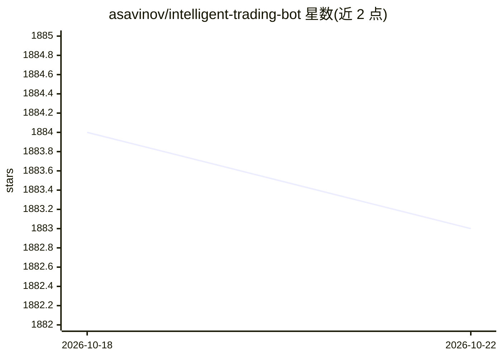

# asavinov/intelligent-trading-bot

⭐ 1,883 · Python · MIT · 推送 2026-08-30 · [GitHub](https://github.com/asavinov/intelligent-trading-bot) · [官网](https://t.me/intelligent_trading_signals) · 个人维护

**基于机器学习与特征工程的加密货币自动交易与信号机器人**

面向加密货币（如 Binance BTCUSDT）的自动交易机器人：离线批处理模式训练 ML 模型，在线流模式用训练好的模型预测并生成交易信号。数据管道覆盖下载、合并、特征工程（talib/tsfresh/itbstats 特征生成器，支持自定义 Python 函数）、标签生成、模型训练、后处理聚合为单一 intelligent indicator，并可发送 Telegram 通知、写数据库或执行真实交易。支持回测与多种时间频率（1 分钟/1 小时/1 天），所有步骤由 JSON 配置文件驱动，通过 scripts 模块中的 python -m 命令依次执行。

## 筛选速览

| 维度 | 判定 | 备注 |
|---|---|---|
| AI 角色 | `ai-native` | 本体是模型或模型工具 |
| 许可风险 | `permissive` | MIT |
| 部署形态 | `None` |  |
| 模型依赖 | — | README 未给出锁定关系 |
| 硬件要求 | — | 无带数字的原话,不猜 |
| 安装摩擦 | `low` | 无编译、无系统依赖或容器化 |
| 成熟度 | — | 结构信号不足 |

## 能力要点

- 离线训练与在线预测严格共用同一套派生特征（设计保证）
- 特征工程支持 talib/tsfresh/itbstats 及自定义 Python 函数
- 信号输出可定制：Telegram 通知、API、数据库存储或执行真实交易
- 多时间频率支持与含周期性重训练的回测功能

## 适用场景

- 训练自己的 ML 模型生成加密货币买卖信号
- 将信号推送到 Telegram 频道或接入自己的交易执行系统
- 在历史数据上回测模型交易表现

## 场景标签

`金融量化` · 领域:学习与行业

## 证据(README 行号)

> L12: The aim of the project is to develop an intelligent trading bot for automated trading including cryptocurrencies us
> L57: * `python -m scripts.train -c config.json`

## 星数曲线

2026-10-18 1,884 → 2026-10-22 1,883（-1）

---
*卡片 v1 · prompt 1.4 · 生成 2026-10-21 · 置信度 high · 依据 README sha `8de63d4c7a57` · [字段定义](../../DATASET.md)*
