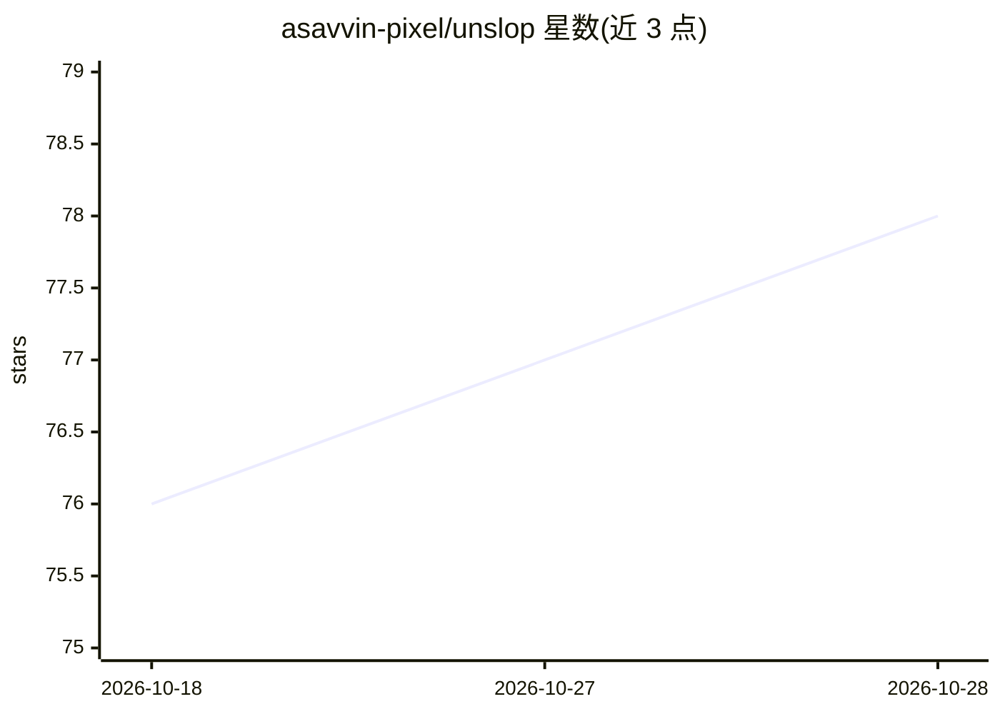

# asavvin-pixel/unslop

⭐ 78 · MIT · 推送 2026-07-14 · [GitHub](https://github.com/asavvin-pixel/unslop) · 个人维护

**给 Claude 用户去除英文文本 AI 写作痕迹的技能**

一个 Claude skill（unslop.skill / SKILL.md 规则集），用于清除英文文本中的 AI 写作痕迹。分三层处理：排版与格式（破折号、粗体、markdown 残留）、19 类词汇修辞模式（附停用清单与前后示例）、结构与认识论规则（禁止编造细节、限制对冲频率）；并支持 'calibrate to my style' 从用户自写文本提取可编辑的风格档案 references/style-profile.md。提供 free/careful/minimal 三种编辑模式，保持文体体裁不变。作者自述首版发布帖仍被社区识别为 AI，v1.1 为改进版；明确声明不以欺骗 AI 检测器为目标。

## 筛选速览

| 维度 | 判定 | 备注 |
|---|---|---|
| AI 角色 | `ai-native` | 本体是模型或模型工具 |
| 许可风险 | `permissive` | MIT |
| 部署形态 | `None` |  |
| 模型依赖 | locked-api |  |
| 硬件要求 | — | 无带数字的原话,不猜 |
| 安装摩擦 | `low` | 无编译、无系统依赖或容器化 |
| 成熟度 | — | 结构信号不足 |

## 能力要点

- 三层规则：排版机制、19 类词汇修辞、结构与认识论
- 风格校准：从用户文本提取可手编的 style-profile.md，支持增量更新
- free/careful/minimal 三种编辑模式，保留原文体裁
- 禁止编造数字/示例/阈值，只允许真实细节

## 适用场景

- 让我用 Claude 写的帖子不像机器生成的
- 按我自己的写作风格改写英文草稿
- 清理邮件或文档中的 AI 式结构与套话

## 场景标签

`AI 写作` · 领域:内容生成

## 证据(README 行号)

> L3: A Claude skill that removes signs of AI writing from English text. Not just the word-level tells ("delve", "it's imp
> L52: **Claude.ai / Claude Desktop:** Settings, Capabilities, Skills, upload `unslop.skill` (or the repo as a ZIP).

## 星数曲线

2026-10-18 76 → 2026-10-28 78（+2）

---
*卡片 v1 · prompt 1.4 · 生成 2026-10-24 · 置信度 high · 依据 README sha `ab7533a2c58e` · [字段定义](../../DATASET.md)*
