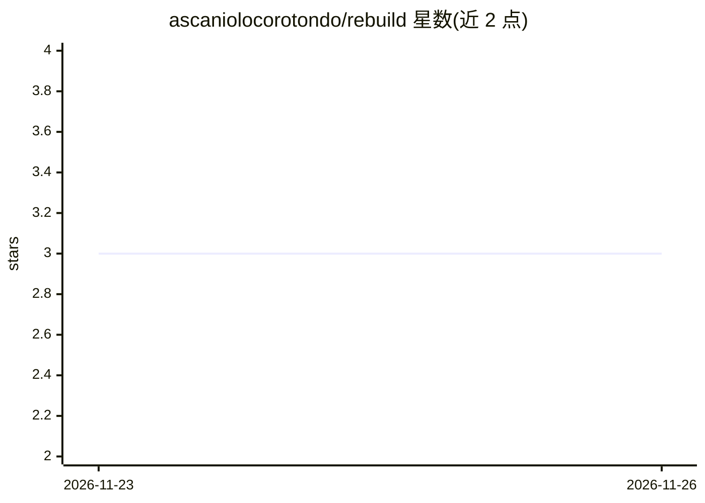

# ascaniolocorotondo/rebuild

⭐ 3 · HTML · MIT · 推送 2026-10-28 · [GitHub](https://github.com/ascaniolocorotondo/rebuild) · [官网](https://ascaniolocorotondo.github.io/rebuild/) · 个人维护 · 中文 README

**Claude 技能：按需重建付费软件的免费替代版**

一个面向 Claude 的技能包：用户用一句话请求（如"做一个免费的 Trello"），技能从 40+ 付费程序的目录中选取用户真正需要的功能，构建完整可运行的应用并自测后交付——单文件离线 HTML 网页应用（数据存浏览器）或在需要访问本地文件时的 Windows Python 应用。目录覆盖图形、办公、生产力、财务、音乐、视频、CAD 等 11 类。仅复刻功能、不使用品牌标识或专有代码；说明与目录以意大利语编写。

## 筛选速览

| 维度 | 判定 | 备注 |
|---|---|---|
| AI 角色 | `ai-native` | 本体是模型或模型工具 |
| 许可风险 | `permissive` | MIT |
| 部署形态 | `None` |  |
| 模型依赖 | locked-api |  |
| 硬件要求 | — | 无带数字的原话,不猜 |
| 安装摩擦 | `low` | 无编译、无系统依赖或容器化 |
| 成熟度 | — | 结构信号不足 |

## 能力要点

- 从 40+ 付费程序目录中选取用户实际使用的功能进行重建
- 交付双击即开的单文件 HTML 离线应用，或 Windows Python 应用
- 构建后先自测再交付
- 内置演示应用 Ritocco 图像编辑器，可在浏览器直接试用

## 适用场景

- 为只用几个功能的付费软件找一个免费替代
- 离线保存数据的个人小工具生成
- 批量重命名、抠图、番茄钟等单功能工具速造

## 场景标签

`编码 Agent` · 领域:编码与开发

## 证据(README 行号)

> L4:  Una skill per Claude che ricrea da zero le funzioni principali dei programmi a pagamento,
> L32: 4. ti dà **un file che apri con doppio clic**: una web app in un solo file HTML, che funziona offline e salva i dat

## 星数曲线

2026-11-23 3 → 2026-11-26 3（+0）

---
*卡片 v1 · prompt 1.4 · 生成 2026-11-23 · 置信度 high · 依据 README sha `c5ec0079bdad` · [字段定义](../../DATASET.md)*
