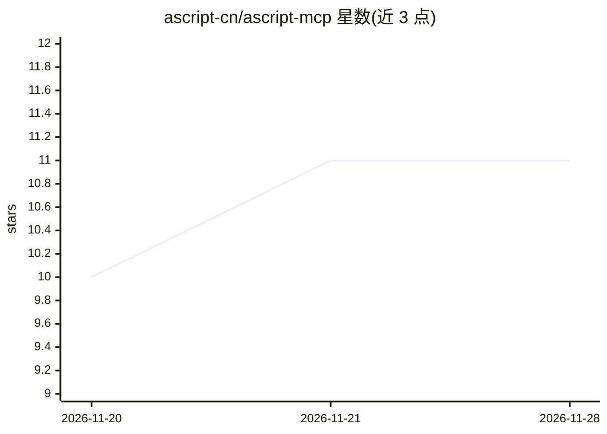

# ascript-cn/ascript-mcp

⭐ 11 · Python · MIT · 推送 2026-04-30 · [GitHub](https://github.com/ascript-cn/ascript-mcp) · 组织维护 · 中文 README

**让 Claude/Cursor 等 AI 工具操控真实设备的 MCP 服务器**

以 MCP 服务器形式连接 AScript 自动化平台与 AI 编程工具，提供 27 个工具：API 文档查询、在线插件检索、设备扫描与连接（Android/iOS/Windows，iOS 免签免越狱）、截图/控件树/OCR/找色等界面观察、工程创建上传运行与设备端 Python REPL。配套 AGENT_RULES.md 规则模板，规定 5 阶段工作流与反模式清单。通过 pip 安装，配置到 Cursor 或 Claude Code 即用，可经 uvicorn 部署为公网 SSE 服务（仅文档查询）。

## 筛选速览

| 维度 | 判定 | 备注 |
|---|---|---|
| AI 角色 | `ai-ecosystem` | LLM/agent 周边工具 |
| 许可风险 | `permissive` | MIT |
| 部署形态 | `library` | 以包/库形式分发 |
| 模型依赖 | locked-api |  |
| 硬件要求 | — | 无带数字的原话,不猜 |
| 安装摩擦 | `low` | 无编译、无系统依赖或容器化 |
| 成熟度 | — | 结构信号不足 |

## 能力要点

- 27 个 MCP 工具覆盖文档查询、设备连接、界面观察、开发部署
- 设备端 Python REPL（eval_python）支持 Android+iOS 直接 exec 验证代码
- 局域网 + ADB 设备扫描与自动连接
- 附 AGENT_RULES.md 规则模板（5 阶段工作流、API 决策树、反模式清单）

## 适用场景

- 在 Cursor/Claude Code 中用自然语言编写并部署设备自动化脚本
- 自动登录、签到、游戏战斗等任务的编排与调试
- 让 AI 通过截图与控件树观察真实设备后迭代脚本

## 场景标签

`GUI 自动化` · 领域:效率与自动化

## 证据(README 行号)

> L9: AScript MCP Service — 让 AI 编程工具（Claude Desktop / Cursor / Trae）直接查询 AScript API 文档、操控真实 Android / iOS 设备（iOS 免签免越狱）。
> L16: - **开发部署**：创建工程、上传代码、运行、停止、查看日志

## 星数曲线

2026-11-20 10 → 2026-11-28 11（+1）

---
*卡片 v1 · prompt 1.4 · 生成 2026-11-20 · 置信度 high · 依据 README sha `a779df4ab32c` · [字段定义](../../DATASET.md)*
