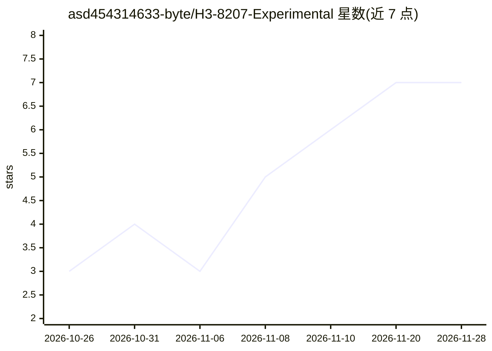

# asd454314633-byte/H3-8207-Experimental

⭐ 7 · Python · NOASSERTION · 推送 2026-11-05 · [GitHub](https://github.com/asd454314633-byte/H3-8207-Experimental) · 个人维护 · 中文 README

**ComfyUI 上的 MiniMax-H3 中文六段连续视频生成实验导演台**

基于 ComfyUI 的工作流项目，把一段故事拆成六段中文提示词分别编辑提交，并通过上一段视频的 Latent（Native masked continuation）续接生成下一段，提供中文操作界面、连续任务调度、Conditioning PreBake 缓存与六段结果合并。支持 Ref2VA/FL2VA 等多种视频模式与三路参考音色。仓库不附带模型权重、素材与密钥，需在独立 ComfyUI 环境自备节点与模型。当前为实验预览版，公开候选的同版本 GPU E2E 未测试。

## 筛选速览

| 维度 | 判定 | 备注 |
|---|---|---|
| AI 角色 | `ai-native` | 本体是模型或模型工具 |
| 许可风险 | `none` | NOASSERTION |
| 部署形态 | `None` |  |
| 模型依赖 | — | README 未给出锁定关系 |
| 硬件要求 | — | 无带数字的原话,不猜 |
| 安装摩擦 | `low` | 无编译、无系统依赖或容器化 |
| 成熟度 | `idea` | |

## 能力要点

- 六段中文提示词分别编辑提交，真实 Latent 跨段续接
- Conditioning PreBake 缓存与运行中编辑、任务快照与队列
- 三路独立参考音色与 <Audio N> 说话人映射
- 可选 AI 导演辅助起草提示词，不限定特定模型

## 适用场景

- 用一段剧情在 ComfyUI 里生成六段连续接续的视频
- 需要保留前段身份与 Latent 状态的中文视频创作流程
- 参考音色配合视频原音轨的多说话人视频生成

## 场景标签

`视频生成` · 领域:内容生成

## 证据(README 行号)

> L31: 把一段故事拆成六段中文提示词，分别编辑、提交生成，并通过真实的上一段 Latent 续接视频。本项目提供中文操作界面、连续任务调度、PreBake 缓存和结果合并，是独立于 8197 正式生产线的**实验源码预览版**。
> L45: |全中文导演台与六段创作|**N159 五个操作阶段+全旁路**（一采、坏段检测、扩时、二采、自动检测修复实验）；六段分别编辑、执行、续跑|前端与节点源码存在；本机指定PDD8六段PASS；公开构建GPU未重跑|
> L107: 1. 在独立 ComfyUI 环境安装所需节点和模型，加载 当前工作流目录 中适合任务的 JSON；配置自己的参考素材和模型路径。

## 星数曲线

2026-10-26 3 → 2026-11-28 7（+4）

---
*卡片 v1 · prompt 1.4 · 生成 2026-11-20 · 置信度 high · 依据 README sha `c3fe3fd105a9` · [字段定义](../../DATASET.md)*
