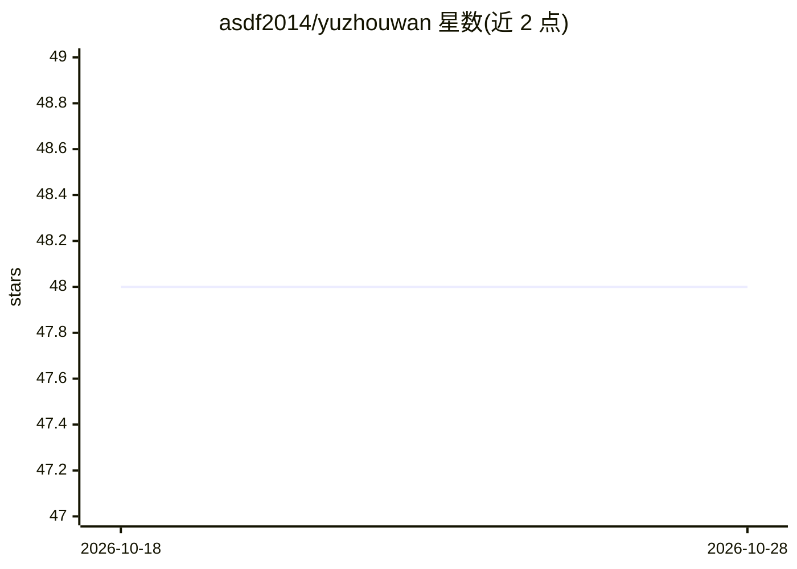

# asdf2014/yuzhouwan

⭐ 48 · Java · Apache-2.0 · 推送 2026-10-26 · [GitHub](https://github.com/asdf2014/yuzhouwan) · [官网](https://yuzhouwan.com) · 个人维护 · 中文 README

**个人博客配套的代码库，涵盖大数据/算法/AI 等技术实践**

博客 yuzhouwan.com 作者维护的个人代码库，内容按模块组织：Maven 进阶、大数据生态（Hadoop/Spark/HBase/Elasticsearch/Druid/Kafka 等）、算法与 Hack 技术、多语言实践（Java/Scala/Python/Shell）、Web 与云原生（Docker/Kubernetes）及通用工具类；其中 Python 部分用于 SQL 解析与 AI。README 主体为博客建站大事记与技术讨论群介绍，未给出具体安装运行方式。

## 筛选速览

| 维度 | 判定 | 备注 |
|---|---|---|
| AI 角色 | `ai-enhanced` | 去掉 AI 部分产品仍成立 |
| 许可风险 | `permissive` | Apache-2.0 |
| 部署形态 | `self-host` | docker 或自建部署 |
| 模型依赖 | — | README 未给出锁定关系 |
| 硬件要求 | — | 无带数字的原话,不猜 |
| 安装摩擦 | `low` | 无编译、无系统依赖或容器化 |
| 成熟度 | — | 结构信号不足 |

## 能力要点

- 覆盖 Hadoop/Spark/HBase/Elasticsearch/Druid 等大数据组件的代码实践
- 算法、多线程、Lambda、代码生成等 Hack 技术模块
- Java/Scala/Python/Shell 多语言实践
- Web（RPC/NIO/Spring）与云原生（Docker/Kubernetes）模块

## 适用场景

- 查阅大数据生态各组件的实践代码示例
- 参考算法与多语言编程技巧
- 了解博客建站历程与技术栈演进

## 场景标签

 · 领域:软件工程/大数据技术实践

## 证据(README 行号)

> L39: ## Code Library for Blog
> L47:  - Java for Most Logic **/** Scala Feature **/** Python for SQL Parser & AI **/** Shell for JVM Monitor

## 星数曲线

2026-10-18 48 → 2026-10-28 48（+0）

---
*卡片 v1 · prompt 1.4 · 生成 2026-10-25 · 置信度 low · 依据 README sha `df5e675ddcc1` · [字段定义](../../DATASET.md)*
