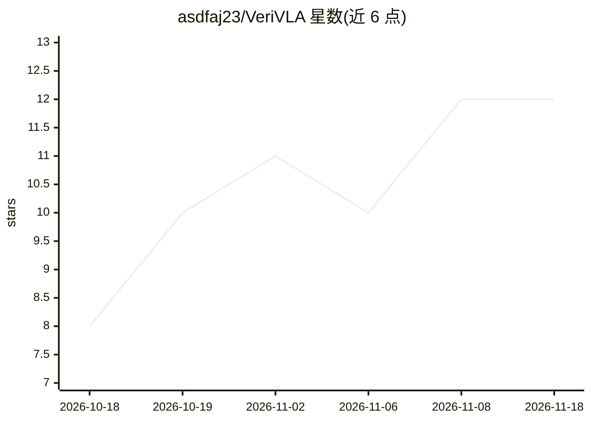

# asdfaj23/VeriVLA

⭐ 12 · Python · 推送 2026-10-10 · [GitHub](https://github.com/asdfaj23/VeriVLA) · 个人维护 · 中文 README

**从零跑通多模态工具调用 Agent 后训练全链路的项目**

以 Qwen3-VL-4B-Instruct 为基座，在自建图表问答与工具调用数据上完成 QLoRA SFT、程序化规则打分的 RM/PPO/DPO/GRPO 训练、AWQ W4A16 量化与 vLLM 部署，并用五模型 13 维评测结果反哺第二轮 GRPO 课程生成。训练采用 QLoRA（视觉塔保持 bf16），部署为 3.3GB 量化权重。仓库附 20+ 条真实报错排查文档（含原始日志）、各阶段超参快照与一键串联脚本。README 声明局限：37 条 SFT 的玩具规模数据、未调优的 PPO 配置、小数据下课程反哺测不出增益。

## 筛选速览

| 维度 | 判定 | 备注 |
|---|---|---|
| AI 角色 | `ai-ecosystem` | LLM/agent 周边工具 |
| 许可风险 | `none` | — |
| 部署形态 | `None` |  |
| 模型依赖 | local-ok | 支持本地模型 |
| 硬件要求 | — | 无带数字的原话,不猜 |
| 安装摩擦 | `medium` | 含编译或系统依赖之一 |
| 成熟度 | — | 结构信号不足 |

## 能力要点

- SFT→RM/PPO→DPO→GRPO→量化→vLLM 部署→评测反哺的完整链路脚本
- 逐步工具合法性奖励（JSON Schema 校验+只读沙箱执行）与跨模态接地奖励
- 20+ 真实报错排查文档，每条附现象、根因、修法与原始日志
- 五模型 13 维同口径评测，McNemar + 配对 bootstrap 统计检验

## 适用场景

- 复现一套多模态工具调用 Agent 的后训练流程
- 参考 RLHF 各阶段在多卡环境下的工程踩坑记录
- 搭建评测反哺数据生成的迭代训练课程

## 场景标签

`强化学习` `微调` `模型量化` `模型评测` · 领域:评测与运维

## 证据(README 行号)

> L3: 一个我自己从零搭到跑通的多模态工具调用 Agent 后训练项目：给 Qwen3-VL-4B 喂自己造的图表问答数据，
> L4: 走完 SFT → RM/PPO → DPO → GRPO → 合并量化 → vLLM 部署 → 独立评测 的整条链路，最后把评测结果反过来
> L16: 造数据 → SFT → RM → PPO → DPO → GRPO → 三重合并校验 → 五模型同口径评测

## 星数曲线

2026-10-18 8 → 2026-11-18 12（+4）

---
*卡片 v1 · prompt 1.4 · 生成 2026-11-18 · 置信度 high · 依据 README sha `edfc4d2400e3` · [字段定义](../../DATASET.md)*
