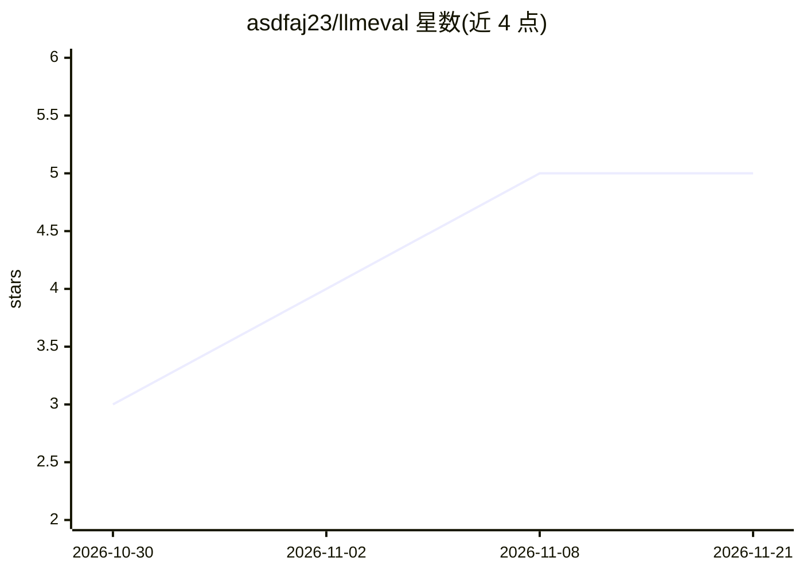

# asdfaj23/llmeval

⭐ 5 · Python · MIT · 推送 2026-10-09 · [GitHub](https://github.com/asdfaj23/llmeval) · 个人维护 · 中文 README

**给开发者的大模型评测框架：368题13维度出HTML报告**

一套可插拔的 LLM 评测框架：内置 368 题、13 个能力维度的题库，三层打分机制（确定性规则、LLM 裁判、子进程执行代码测试），并做裁判偏差控制（位置/冗长/自偏好）与裁判校准（κ 阈值）。模型比较强制过配对 McNemar 检验加 bootstrap 置信区间，跑完输出单文件 HTML 报告。唯一运行时依赖为 PyYAML，HTTP 用标准库，纯 CPU、离线可跑；不提供容器级沙箱，代码执行为子进程弱隔离。

## 筛选速览

| 维度 | 判定 | 备注 |
|---|---|---|
| AI 角色 | `ai-ecosystem` | LLM/agent 周边工具 |
| 许可风险 | `permissive` | MIT |
| 部署形态 | `library` | 以包/库形式分发 |
| 模型依赖 | — | README 未给出锁定关系 |
| 硬件要求 | — | 无带数字的原话,不猜 |
| 安装摩擦 | `low` | 无编译、无系统依赖或容器化 |
| 成熟度 | — | 结构信号不足 |

## 能力要点

- 三层判定：确定性规则、LLM 裁判评审团（中位数聚合）、真实执行代码测试
- 配对 McNemar 检验加 bootstrap 95% 置信区间，分差不过检验不写结论
- 裁判校准（κ 阈值）与位置/冗长/自偏好偏差度量
- 评测环境隔离审计：canary 泄漏扫描与工具轨迹审计，368 题零泄漏

## 适用场景

- 横向对比两个模型，出一份带统计检验的单文件报告
- 评测自己的 agent 或多智能体框架（工具调用、轨迹审计）
- 按维度短板画像决定要补什么训练数据
- 检查被测模型在评测中是否有翻答案、越权调工具等泄漏行为

## 场景标签

`模型评测` · 领域:评测与运维

## 证据(README 行号)

> L3: 自己写的一套大模型评测框架。368 道题、13 个能力维度、三层判定，跑完一条命令出一份单文件 HTML 报告，全程离线也能跑。
> L9: 运行时依赖只有一个 PyYAML：HTTP 走标准库 `urllib`，统计也是手写的，纯 CPU 可跑，不要 GPU，也不要 Docker。
> L58: provider 内置了火山方舟、DeepSeek、Moonshot、通义、智谱、OpenAI，全部走 OpenAI 兼容协议，换服务商只改 `base_url`。

## 星数曲线

2026-10-30 3 → 2026-11-21 5（+2）

---
*卡片 v1 · prompt 1.4 · 生成 2026-11-21 · 置信度 high · 依据 README sha `0b6f07480bb0` · [字段定义](../../DATASET.md)*
