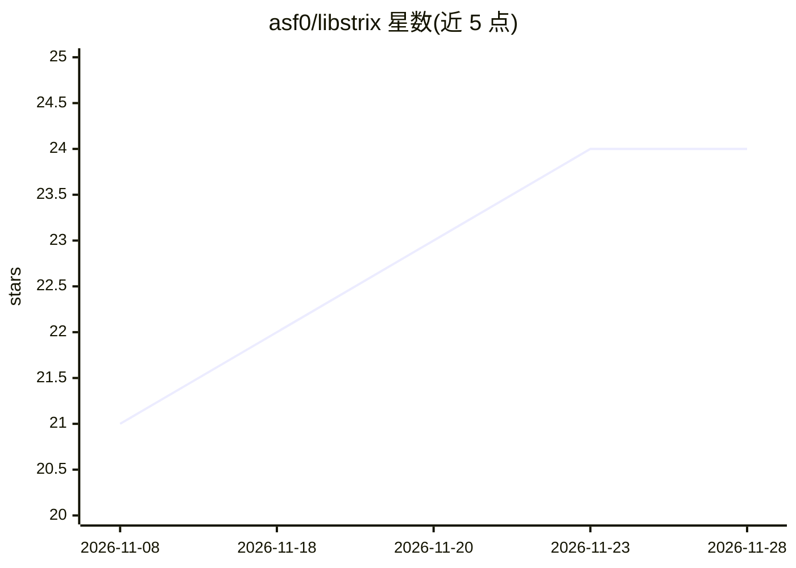

# asf0/libstrix

⭐ 24 · Python · MIT · 推送 2026-11-27 · [GitHub](https://github.com/asf0/libstrix) · 个人维护

**AMD Strix Halo 上加速 vLLM 推理的 HIP 内核插件**

面向 AMD Strix Halo（gfx1151 / Ryzen AI Max / Radeon 8060S）的 vLLM 插件：提供针对该 APU 调优的 HIP 内核（attention、GDN、GEMM、MoE、norm），通过 vllm.general_plugins 入口点替换 stock vLLM 内核，无需改动 vLLM 源码；可选将 prefill 输入投影放到 XDNA2 NPU 上执行。Docker 镜像内置 ROCm 10.1，一条 compose 命令即可经 OpenAI 兼容 API 服务 Qwen、gemma、LFM 等模型。限制：内核按单一几何形状编译、拒绝其他 shape，插件在其他 GPU 上为 no-op；宿主需一次性内核参数与 BIOS 配置；源码构建需 ROCm 与 gfx1151 APU。README 给出对比 stock vLLM 的 prefill/decode 加速与精度（KLD、GSM8K）数据。

## 筛选速览

| 维度 | 判定 | 备注 |
|---|---|---|
| AI 角色 | `ai-ecosystem` | LLM/agent 周边工具 |
| 许可风险 | `permissive` | MIT |
| 部署形态 | `self-host` | docker 或自建部署 |
| 模型依赖 | local-ok | 支持本地模型 |
| 硬件要求 | — | 无带数字的原话,不猜 |
| 安装摩擦 | `low` | 无编译、无系统依赖或容器化 |
| 成熟度 | — | 结构信号不足 |

## 能力要点

- HIP 内核经 vLLM 插件入口点替换 stock 内核，无需改 vLLM 源码
- 可选 XDNA2 NPU 执行 prefill 输入投影（TTFT 降低 7-8%）
- ghcr.io/asf0/strix-vllm 镜像内置 ROCm 10.1，每模型一份 compose recipe
- 投机解码 DFlash 2 / DSpark 与 int8 KV cache 支持

## 适用场景

- 在 Strix Halo 128GB 内存上长上下文本地部署大模型
- 为已有 vLLM 流程加速 gfx1151 上的 prefill 与 decode
- A/B 对比插件内核与 stock vLLM 的性能和精度

## 场景标签

`推理引擎` · 领域:训练与推理

## 证据(README 行号)

> L17: Under the hood: HIP kernels tuned for gfx1151, a vLLM plugin that swaps them
> L143: Installing the package registers the `vllm.general_plugins` entry point

## 星数曲线

2026-11-08 21 → 2026-11-28 24（+3）

---
*卡片 v1 · prompt 1.4 · 生成 2026-11-18 · 置信度 high · 依据 README sha `b8c611e73a0f` · [字段定义](../../DATASET.md)*
