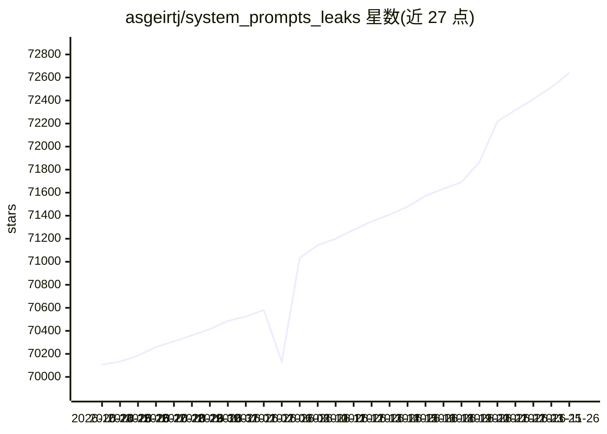

# asgeirtj/system_prompts_leaks

⭐ 72,640 · Python · CC0-1.0 · 推送 2026-11-24 · [GitHub](https://github.com/asgeirtj/system_prompts_leaks) · 个人维护

**主流聊天机器人泄露系统提示词的归档清单，供研究者查阅**

按厂商与产品组织的系统提示词文本集合：覆盖 Anthropic Claude、OpenAI ChatGPT/Codex、Google Gemini、xAI Grok、Meta Muse、Perplexity、Cursor、Mistral、Kimi、Qwen、GLM、MiniMax、Copilot 等，收录 2025 年 5 月以来的多个版本，含 Claude Code、Gemini CLI、API 注入提示词与已废弃产品的历史提示词。以表格链接形式组织条目，接受 PR 更新。无安装与运行步骤，纯文档仓库；README 声明被媒体与学术论文引用。

## 筛选速览

| 维度 | 判定 | 备注 |
|---|---|---|
| AI 角色 | `ai-knowledge` | 知识聚合/清单类 |
| 许可风险 | `viral` | CC0-1.0 |
| 部署形态 | `None` |  |
| 模型依赖 | — | README 未给出锁定关系 |
| 硬件要求 | — | 无带数字的原话,不猜 |
| 安装摩擦 | `low` | 无编译、无系统依赖或容器化 |
| 成熟度 | — | 结构信号不足 |

## 动量与使用信号

- 维护:`active` — 距上次 push 2.0 天,年发版 0,25 位贡献者
- 涨星:近 1 天 **+69**(自 20261016 起算)
- 安装:github 包 `release-assets` 月下载无数据

## 能力要点

- 按厂商/产品/版本组织的系统提示词文本目录
- 收录 2025 年 5 月以来的历史版本与废弃产品提示词
- 包含 Claude Code、Codex、Gemini CLI 等编码工具的系统提示词
- 接受 PR 补充与更正

## 适用场景

- 查阅某款聊天机器人当前或历史版本的系统提示词
- 研究提示词随版本迭代的变化
- 为提示词相关学术研究查找原始文本

## 场景标签

`提示工程` `精选清单` · 领域:Agent 开发

## 证据(README 行号)

> L1: # System Prompts Leaks
> L25: |What|Date|Link|
> L44: |Model|Prompt|

## 星数曲线

2026-10-24 70,106 → 2026-11-26 72,640（+2,534）

---
*卡片 v1 · prompt 1.4 · 生成 2026-11-26 · 置信度 high · 依据 README sha `9d847723dc5f` · [字段定义](../../DATASET.md)*
