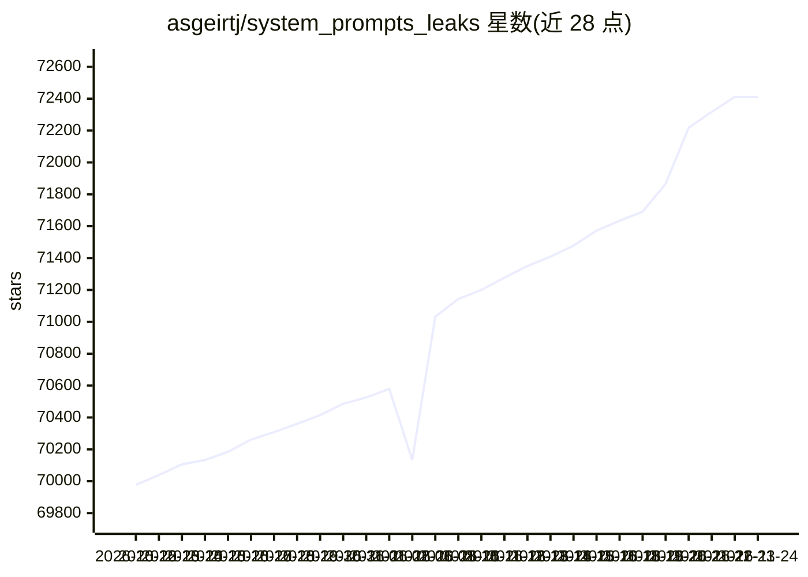

# asgeirtj/system_prompts_leaks

⭐ 72,411 · Python · CC0-1.0 · 推送 2026-11-20 · [GitHub](https://github.com/asgeirtj/system_prompts_leaks) · 个人维护

**主流聊天机器人泄露系统提示词的汇总存档**

收录 ChatGPT、Claude、Gemini、Grok 等 30+ 产品的泄露系统提示词全文，按厂商与产品分节组织成表格，含模型版本、工具提示词、技能定义等条目，并记录每日更新日志与历史版本。README 未提供安装或运行方式，纯静态清单；内容来自泄露渠道，README 邀请用户提交 PR 补充不同抓取结果。被华盛顿邮报、CEPS、Simon Willison 等引用为来源。

## 筛选速览

| 维度 | 判定 | 备注 |
|---|---|---|
| AI 角色 | `ai-knowledge` | 知识聚合/清单类 |
| 许可风险 | `viral` | CC0-1.0 |
| 部署形态 | `None` |  |
| 模型依赖 | — | README 未给出锁定关系 |
| 硬件要求 | — | 无带数字的原话,不猜 |
| 安装摩擦 | `low` | 无编译、无系统依赖或容器化 |
| 成熟度 | — | 结构信号不足 |

## 动量与使用信号

- 维护:`active` — 距上次 push 2.0 天,年发版 0,25 位贡献者
- 涨星:近 1 天 **+69**(自 20261016 起算)
- 安装:github 包 `release-assets` 月下载无数据

## 能力要点

- 按厂商/产品/版本组织的系统提示词全文表格
- 覆盖 30+ 产品，每日更新并列出最近变更
- 含 Claude Code、Codex、Gemini CLI 等编码工具的提示词

## 适用场景

- 查看某版本模型官方系统提示词的原文内容
- 研究各厂商提示词写法与工具定义结构
- 追踪提示词随版本的变更记录

## 场景标签

`精选清单` · 领域:学习与行业

## 证据(README 行号)

> L1: # System Prompts Leaks
> L3: Leaked system prompts of ChatGPT, Claude, Gemini and more. The hidden system prompt of every popular chatbot, in ful
> L38: ## Anthropic — Claude

## 星数曲线

2026-10-22 69,977 → 2026-11-24 72,411（+2,434）

---
*卡片 v1 · prompt 1.4 · 生成 2026-11-22 · 置信度 high · 依据 README sha `73cf986d03c1` · [字段定义](../../DATASET.md)*
