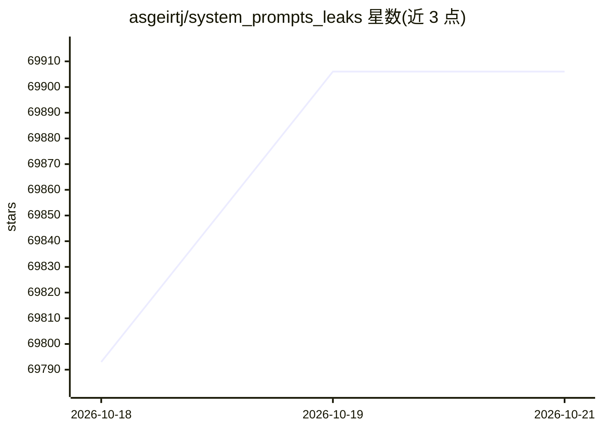

# asgeirtj/system_prompts_leaks

⭐ 69,906 · Python · CC0-1.0 · 推送 2026-10-16 · [GitHub](https://github.com/asgeirtj/system_prompts_leaks) · 个人维护

**收录各家聊天产品系统提示词原文的资料集**

以 Markdown 目录形式聚合多家 AI 产品的系统提示词全文，按厂商分节（Anthropic、OpenAI、Google、xAI、Meta、Perplexity、Cursor、Moonshot、DeepSeek、Qwen、Microsoft 等），每个条目附链接指向仓库内文件；维护“最近新增”变更表，标注旧模型与弃用功能的提示词归档分区；欢迎通过 PR 提交新抓取结果，README 声明定期更新。仓库为纯资料集合，无安装或运行说明。

## 筛选速览

| 维度 | 判定 | 备注 |
|---|---|---|
| AI 角色 | `ai-knowledge` | 知识聚合/清单类 |
| 许可风险 | `viral` | CC0-1.0 |
| 部署形态 | `None` |  |
| 模型依赖 | — | README 未给出锁定关系 |
| 硬件要求 | — | 无带数字的原话,不猜 |
| 安装摩擦 | `low` | 无编译、无系统依赖或容器化 |
| 成熟度 | — | 结构信号不足 |

## 动量与使用信号

- 维护:`active` — 距上次 push 2.0 天,年发版 0,25 位贡献者
- 涨星:近 1 天 **+69**(自 20261016 起算)
- 安装:github 包 `release-assets` 月下载无数据

## 能力要点

- 收录 20 余家厂商产品的系统提示词原文链接
- Claude 按模型版本、Claude Code 形态（桌面/云/headless/子代理）分目录
- OpenAI 区分 ChatGPT、Codex、API 注入提示词与弃用功能分区
- 维护带日期的最近新增/变更表

## 适用场景

- 查阅特定版本聊天产品的系统提示词内容
- 研究不同厂商提示词的组织方式与差异
- 跟踪各家产品提示词的更新记录

## 场景标签

`精选清单` · 领域:学习与行业

## 证据(README 行号)

> L10: # System Prompts Leaks
> L12: The full verbatim system prompts behind the most popular chatbots in the world. Carefully curated and complete. Fee

## 星数曲线

2026-10-18 69,793 → 2026-10-21 69,906（+113）

---
*卡片 v1 · prompt 1.4 · 生成 2026-10-18 · 置信度 high · 依据 README sha `3b67973d1e5b` · [字段定义](../../DATASET.md)*
